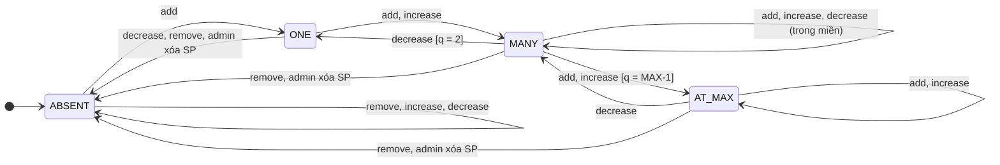
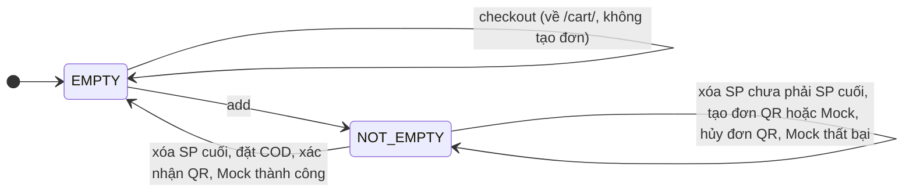

# KIỂM THỬ HỘP ĐEN – FR3: CHUYỂN ĐỔI TRẠNG THÁI & BẢNG QUYẾT ĐỊNH

| Thông tin | Chi tiết |
| :--- | :--- |
| Hệ thống | Green Shop |
| Phân hệ | FR3 – Quản lý giỏ hàng (UC03) |
| Người thực hiện | Lê Bá Hoài Phong |
| Kỹ thuật | Kiểm thử chuyển đổi trạng thái (State Transition Testing), Bảng quyết định (Decision Table) |
| Công cụ thực thi | Django TestCase – [`cart/tests_state_transition.py`](../cart/tests_state_transition.py), [`cart/tests_decision_table.py`](../cart/tests_decision_table.py); CodeceptJS – [`tests/cart_decision_test.js`](../tests/cart_decision_test.js) |
| Ngày thực thi | 09/11/2026 |
| Báo cáo chi tiết | [`cart_state_decision_report.xlsx`](cart_state_decision_report.xlsx) |

**Kết quả:** 55 test case, 53 PASS, 2 FAIL. Hai test case FAIL cùng do một lỗi mới, **BUG-CART-02**, chưa được sửa ([mục 6](#6-lỗi-và-điểm-lệch-đặc-tả)).

> Ký hiệu: `q` là `CartItem.quantity`; `MAX` là 2.147.483.647, giới hạn của `PositiveIntegerField` (xem BUG-CART-01 trong [tài liệu EP & BVA](TestCase_FR3_Cart_EP_BVA.md)). SP A *Bình nước tre* = 50.000đ, SP B *Túi vải canvas* = 30.000đ.

---

# PHẦN A. KIỂM THỬ CHUYỂN ĐỔI TRẠNG THÁI

Phân tích quan hệ giữa trạng thái, sự kiện và hành động gây ra chuyển đổi. Giỏ hàng có 2 máy trạng thái: một cho **từng sản phẩm trong giỏ**, một cho **cả giỏ hàng**.

## 1. Máy trạng thái của một sản phẩm trong giỏ

### 1.1 Xác định các trạng thái

| Trạng thái | Điều kiện | Giá trị đại diện khi test |
| :--- | :--- | :--- |
| `ABSENT` | Không có `CartItem` của SP trong giỏ | – |
| `ONE` | `q = 1` | 1 |
| `MANY` | `1 < q < MAX` | 5; biên: 2 và `MAX − 1` |
| `AT_MAX` | `q = MAX` | 2.147.483.647 |

### 1.2 Xác định các sự kiện

| Sự kiện | Input | Yêu cầu |
| :--- | :--- | :--- |
| `add` | `GET /cart/add/<id>/` | FR3.1 |
| `increase` | `GET /cart/increase/<id>/` | FR3.3 |
| `decrease` | `GET /cart/decrease/<id>/` | FR3.3 |
| `remove` | `GET /cart/remove/<id>/` | FR3.4 |
| `admin xóa SP` | Xóa `Product` (ràng buộc `on_delete=CASCADE`) | Hệ quả của mô hình dữ liệu |

### 1.3 Sơ đồ chuyển trạng thái



### 1.4 Bảng chuyển trạng thái

Mỗi ô ghi trạng thái kết thúc và mã HTTP.

| Trạng thái đầu | `add` | `increase` | `decrease` | `remove` | `admin xóa SP` |
| :--- | :---: | :---: | :---: | :---: | :---: |
| `ABSENT` | `ONE` · 302 | `ABSENT` · **404** | `ABSENT` · **404** | `ABSENT` · 302 | – |
| `ONE` | `MANY` · 302 | `MANY` · 302 | `ABSENT` · 302 | `ABSENT` · 302 | `ABSENT` |
| `MANY` | `MANY`, hoặc `AT_MAX` nếu `q = MAX − 1` · 302 | `MANY`, hoặc `AT_MAX` nếu `q = MAX − 1` · 302 | `MANY`, hoặc `ONE` nếu `q = 2` · 302 | `ABSENT` · 302 | `ABSENT` |
| `AT_MAX` | `AT_MAX` · 302 | `AT_MAX` · 302 | `MANY` · 302 | `ABSENT` · 302 | `ABSENT` |

### 1.5 Test case

Toàn bộ 4 trạng thái × 4 sự kiện (`TC-CART-ST-01`, 16 sub-test):

| Mã TC | Start state | Input | Expected Output | End state | KQ |
| :--- | :--- | :--- | :--- | :--- | :---: |
| ST-01.01 | `ABSENT` | `add` | 302, `q = 1` | `ONE` | ✅ PASS |
| ST-01.02 | `ABSENT` | `increase` | 404, không tạo `CartItem` | `ABSENT` | ✅ PASS |
| ST-01.03 | `ABSENT` | `decrease` | 404 | `ABSENT` | ✅ PASS |
| ST-01.04 | `ABSENT` | `remove` | 302, không lỗi | `ABSENT` | ✅ PASS |
| ST-01.05 | `ONE` | `add` | 302, `q = 2` | `MANY` | ✅ PASS |
| ST-01.06 | `ONE` | `increase` | 302, `q = 2` | `MANY` | ✅ PASS |
| ST-01.07 | `ONE` | `decrease` | 302, xóa `CartItem` | `ABSENT` | ✅ PASS |
| ST-01.08 | `ONE` | `remove` | 302, xóa `CartItem` | `ABSENT` | ✅ PASS |
| ST-01.09 | `MANY` (`q = 5`) | `add` | 302, `q = 6` | `MANY` | ✅ PASS |
| ST-01.10 | `MANY` (`q = 5`) | `increase` | 302, `q = 6` | `MANY` | ✅ PASS |
| ST-01.11 | `MANY` (`q = 5`) | `decrease` | 302, `q = 4` | `MANY` | ✅ PASS |
| ST-01.12 | `MANY` (`q = 5`) | `remove` | 302, xóa `CartItem` | `ABSENT` | ✅ PASS |
| ST-01.13 | `AT_MAX` | `add` | 302, giữ `q = MAX`, không 500 | `AT_MAX` | ✅ PASS |
| ST-01.14 | `AT_MAX` | `increase` | 302, giữ `q = MAX`, không 500 | `AT_MAX` | ✅ PASS |
| ST-01.15 | `AT_MAX` | `decrease` | 302, `q = MAX − 1` | `MANY` | ✅ PASS |
| ST-01.16 | `AT_MAX` | `remove` | 302, xóa `CartItem` | `ABSENT` | ✅ PASS |

Biên của guard, chuỗi chuyển nhiều bước và các trường hợp không được đổi trạng thái:

| Mã TC | Start state | Input | Expected Output | End state | KQ |
| :--- | :--- | :--- | :--- | :--- | :---: |
| TC-CART-ST-02 | `MANY` (`q = 2`) | `decrease` | `q = 1` | `ONE` | ✅ PASS |
| TC-CART-ST-03 | `MANY` (`q = MAX − 1`) | `add`; `increase` (2 sub-test) | `q = MAX` | `AT_MAX` | ✅ PASS |
| TC-CART-ST-04 | `ABSENT` | `add`, `increase`, `add`, `decrease`, `decrease`, `decrease` | `q` lần lượt 1, 2, 3, 2, 1, bị xóa | `ABSENT` | ✅ PASS |
| TC-CART-ST-05 | `MANY` (`q = MAX − 1`) | `increase`, `add`, `decrease`, `add`, `remove` | `q` lần lượt `MAX`, `MAX`, `MAX − 1`, `MAX`, bị xóa | `ABSENT` | ✅ PASS |
| TC-CART-ST-06 | `MANY` (`q = 5`) | `remove`, rồi `add` | `q = 1`, không giữ số lượng cũ | `ONE` | ✅ PASS |
| TC-CART-ST-07 | A `MANY` (`q = 2`), B `q = 3` | 4 sự kiện trên A | B vẫn `q = 3` | B không đổi | ✅ PASS |
| TC-CART-ST-08 | `MANY` (`q = 2`), đã đăng xuất | 4 sự kiện | 302 → login, `q = 2` | `MANY` | ✅ PASS |
| TC-CART-ST-09 | `ABSENT`, khách | `add` → đăng nhập → quay lại URL `next` | `q = 1` | `ONE` | ✅ PASS |
| TC-CART-ST-16 | `MANY` (`q = 2`) của user 1 | User 2 thực hiện 4 sự kiện trên cùng SP | Giỏ user 1 vẫn `q = 2` (BR03.1) | `MANY` | ✅ PASS |
| TC-CART-ST-17 | `ONE` / `MANY` / `AT_MAX` (3 sub-test) | `admin xóa SP` | `CartItem` bị xóa, `/cart/` vẫn trả 200 | `ABSENT` | ✅ PASS |

## 2. Máy trạng thái của cả giỏ hàng

### 2.1 Xác định các trạng thái và sơ đồ

| Trạng thái | Điều kiện |
| :--- | :--- |
| `EMPTY` | Giỏ không có `CartItem` |
| `NOT_EMPTY` | Giỏ có ít nhất 1 `CartItem` |



> Luồng QR theo hành vi sau SCRUM-43; SRS chưa cập nhật điểm này (xem [mục 6.2](#62-điểm-lệch-đặc-tả-cần-nhóm-thống-nhất)).

### 2.2 Test case

| Mã TC | Start state | Input | Expected Output | End state | KQ |
| :--- | :--- | :--- | :--- | :--- | :---: |
| TC-CART-ST-10 | `NOT_EMPTY` (A×1, B×1) | `remove` A, rồi `decrease` B | Sau bước 1 còn B; sau bước 2 hiện *"Giỏ hàng của bạn đang trống"* | `EMPTY` | ✅ PASS |
| TC-CART-ST-11 | `EMPTY` | `POST /orders/checkout/` | 302 → `/cart/`, không tạo đơn | `EMPTY` | ✅ PASS |
| TC-CART-ST-12 | `NOT_EMPTY` (A×2) | Đặt COD | Tạo đơn, xóa hết `CartItem` | `EMPTY` | ✅ PASS |
| TC-CART-ST-13 | `NOT_EMPTY` (A×2) | Đặt QR, rồi xác nhận đã chuyển khoản | Sau bước 1 giỏ còn nguyên; sau bước 2 rỗng | `EMPTY` | ✅ PASS |
| TC-CART-ST-14 | `NOT_EMPTY` (A×2) | Đặt Mock, rồi thanh toán thành công | Sau bước 1 giỏ còn nguyên; sau bước 2 rỗng | `EMPTY` | ✅ PASS |
| TC-CART-ST-15 | `NOT_EMPTY` (A×2) | Đặt Mock, rồi thanh toán thất bại | Giỏ giữ A×2 | `NOT_EMPTY` | ✅ PASS |
| TC-CART-ST-18 | `NOT_EMPTY` (A×2), có đơn QR chờ | `POST /orders/<id>/cancel/` | 302 → `/cart/`, đơn `cancelled`, giỏ giữ A×2 | `NOT_EMPTY` | ✅ PASS |
| TC-CART-ST-19 | `NOT_EMPTY` (B×1), đơn QR đã `paid` | Xác nhận lại đơn QR | Giỏ mới không bị xóa | `NOT_EMPTY` | ✅ PASS |
| TC-CART-ST-20 | `NOT_EMPTY` (A×2), đơn QR đã `cancelled` | Xác nhận đơn QR | Đơn vẫn `cancelled`, giỏ giữ A×2 | `NOT_EMPTY` | ✅ PASS |
| TC-CART-ST-21 | `NOT_EMPTY` (A×2), đơn QR chờ, sau đó `add` B | Xác nhận đơn QR | B không có trong đơn nên phải còn trong giỏ. **Thực tế: B bị xóa** | `NOT_EMPTY` | ❌ FAIL – BUG-CART-02 |
| TC-CART-ST-22 | `NOT_EMPTY` (A×2), đơn Mock chờ, sau đó `add` B | Mock thành công | B không có trong đơn nên phải còn trong giỏ. **Thực tế: B bị xóa** | `NOT_EMPTY` | ❌ FAIL – BUG-CART-02 |

Chuyển `EMPTY → NOT_EMPTY` được kiểm tra trong ST-01.01 và ST-04.

---

# PHẦN B. BẢNG QUYẾT ĐỊNH

## 3. Cấu trúc và các bước thực hiện

Mỗi bảng gồm 3 phần: **Conditions** (điều kiện đầu vào), **Actions** (kết quả của sự kết hợp điều kiện) và **Rules** (luật kết hợp các điều kiện).

| Bước | Nội dung | Vị trí trong tài liệu |
| :---: | :--- | :--- |
| 1 | Liệt kê conditions và giá trị | Phần Conditions của mỗi bảng |
| 2 | Liệt kê actions | Phần Actions của mỗi bảng |
| 3 | Tính số rules lớn nhất | Tích số giá trị của các condition, [mục 4](#4-số-rules-trước-và-sau-khi-rút-gọn) |
| 4 | Xác định rules từ tổ hợp giá trị | Bảng đầy đủ ở [mục 5.1](#51-bảng-đầy-đủ-16-rules-trước-khi-rút-gọn) |
| 5 | Đánh dấu `X` vào action tương ứng | Bảng đầy đủ và các bảng rút gọn |
| 6 | Rút gọn bảng | [Mục 5.2](#52-bảng-1-thêm-sản-phẩm-get-cartaddid-sau-khi-rút-gọn) → [5.8](#58-bảng-7-dọn-giỏ-khi-đặt-hàng-và-thanh-toán-fr35) |

Ký hiệu: `Y` là đúng, `N` là sai, `–` là không ảnh hưởng đến kết quả.

## 4. Số rules trước và sau khi rút gọn

| Bảng | Chức năng | Conditions (số giá trị) | Rules lớn nhất | Sau rút gọn | Mã luật |
| :---: | :--- | :--- | :---: | :---: | :---: |
| 1 | Thêm SP | 2 × 2 × 2 × 2 | 16 | 5 | R1–R5 |
| 2 | Tăng số lượng | 2 × 2 × 2 × 2 | 16 | 5 | R6–R10 |
| 3 | Giảm số lượng | 2 × 2 × 2 × 2 | 16 | 5 | R11–R15 |
| 4 | Xóa khỏi giỏ | 2 × 2 × 2 | 8 | 4 | R16–R19 |
| 5 | Xem giỏ hàng | 2 × 2 | 4 | 3 | R20–R22 |
| 6 | Số trên biểu tượng giỏ | 2 × 2 | 4 | 3 | R23–R25 |
| 7 | Dọn giỏ khi đặt hàng (FR3.5) | 2 × 3 × 4 | 24 | 8 | R26–R33 |
| | **Tổng** | | **88** | **33** | |

## 5. Các bảng quyết định

### 5.1 Bảng đầy đủ 16 rules trước khi rút gọn

Lấy chức năng **Thêm sản phẩm** làm ví dụ cho các bước 3, 4 và 5.

| | 1 | 2 | 3 | 4 | 5 | 6 | 7 | 8 | 9 | 10 | 11 | 12 | 13 | 14 | 15 | 16 |
| :--- | :---: | :---: | :---: | :---: | :---: | :---: | :---: | :---: | :---: | :---: | :---: | :---: | :---: | :---: | :---: | :---: |
| **Conditions** | | | | | | | | | | | | | | | | |
| C1: Đã đăng nhập | Y | Y | Y | Y | Y | Y | Y | Y | N | N | N | N | N | N | N | N |
| C2: SP tồn tại | Y | Y | Y | Y | N | N | N | N | Y | Y | Y | Y | N | N | N | N |
| C3: SP có trong giỏ | Y | Y | N | N | Y | Y | N | N | Y | Y | N | N | Y | Y | N | N |
| C4: `q = MAX` | Y | N | Y | N | Y | N | Y | N | Y | N | Y | N | Y | N | Y | N |
| **Actions** | | | | | | | | | | | | | | | | |
| A1: Chuyển login kèm `next` | | | | | | | | | X | X | X | X | X | X | X | X |
| A2: Báo 404 | | | | | X | X | X | X | | | | | | | | |
| A3: Tạo `CartItem`, `q = 1` | | | X | X | | | | | | | | | | | | |
| A4: `q + 1` | | X | | | | | | | | | | | | | | |
| A5: Giữ nguyên `q` | X | | | | | | | | | | | | | | | |
| A6: 302 về `/cart/` | X | X | X | X | | | | | | | | | | | | |

Cách rút gọn (bước 6):

- **Cột 9–16 → R1:** khách luôn bị chuyển sang login trước khi hệ thống tra cứu SP.
- **Cột 5–8 → R2:** SP không tồn tại luôn trả 404. Cột 5, 6, 13, 14 không xảy ra được vì xóa SP sẽ xóa luôn `CartItem` (`CASCADE`).
- **Cột 3–4 → R3:** SP chưa có trong giỏ thì C4 không có ý nghĩa.
- **Cột 2 → R4, cột 1 → R5:** giữ nguyên.

### 5.2 Bảng 1: Thêm sản phẩm (`GET /cart/add/<id>/`) sau khi rút gọn

| | R1 | R2 | R3 | R4 | R5 |
| :--- | :---: | :---: | :---: | :---: | :---: |
| C1: Đã đăng nhập | N | Y | Y | Y | Y |
| C2: SP tồn tại | – | N | Y | Y | Y |
| C3: SP có trong giỏ | – | – | N | Y | Y |
| C4: `q = MAX` | – | – | – | N | Y |
| A1: Chuyển login kèm `next` | X | | | | |
| A2: Báo 404 | | X | | | |
| A3: Tạo `CartItem`, `q = 1` | | | X | | |
| A4: `q + 1` | | | | X | |
| A5: Giữ nguyên `q` | | | | | X |
| A6: 302 về `/cart/` | | | X | X | X |
| **Kết quả** | ✅ | ✅ | ✅ | ✅ | ✅ |

### 5.3 Bảng 2: Tăng số lượng (`GET /cart/increase/<id>/`)

Khác Bảng 1 ở chỗ SP chưa có trong giỏ thì báo 404, không tự tạo mới.

| | R6 | R7 | R8 | R9 | R10 |
| :--- | :---: | :---: | :---: | :---: | :---: |
| C1: Đã đăng nhập | N | Y | Y | Y | Y |
| C2: SP tồn tại | – | N | Y | Y | Y |
| C3: SP có trong giỏ | – | – | N | Y | Y |
| C4: `q = MAX` | – | – | – | N | Y |
| A1: Chuyển login kèm `next` | X | | | | |
| A2: Báo 404, không tạo `CartItem` | | X | X | | |
| A3: `q + 1` | | | | X | |
| A4: Giữ nguyên `q` | | | | | X |
| A5: 302 về `/cart/` | | | | X | X |
| **Kết quả** | ✅ | ✅ | ✅ | ✅ | ✅ |

### 5.4 Bảng 3: Giảm số lượng (`GET /cart/decrease/<id>/`)

| | R11 | R12 | R13 | R14 | R15 |
| :--- | :---: | :---: | :---: | :---: | :---: |
| C1: Đã đăng nhập | N | Y | Y | Y | Y |
| C2: SP tồn tại | – | N | Y | Y | Y |
| C3: SP có trong giỏ | – | – | N | Y | Y |
| C4: `q = 1` | – | – | – | Y | N |
| A1: Chuyển login kèm `next` | X | | | | |
| A2: Báo 404 | | X | X | | |
| A3: Xóa `CartItem` | | | | X | |
| A4: `q − 1` | | | | | X |
| A5: 302 về `/cart/` | | | | X | X |
| **Kết quả** | ✅ | ✅ | ✅ | ✅ | ✅ |

### 5.5 Bảng 4: Xóa khỏi giỏ (`GET /cart/remove/<id>/`)

Không phụ thuộc số lượng nên chỉ có 3 condition.

| | R16 | R17 | R18 | R19 |
| :--- | :---: | :---: | :---: | :---: |
| C1: Đã đăng nhập | N | Y | Y | Y |
| C2: SP tồn tại | – | N | Y | Y |
| C3: SP có trong giỏ | – | – | N | Y |
| A1: Chuyển login kèm `next` | X | | | |
| A2: Báo 404 | | X | | |
| A3: Xóa `CartItem` | | | | X |
| A4: 302 về `/cart/`, không lỗi | | | X | X |
| **Kết quả** | ✅ | ✅ | ✅ | ✅ |

### 5.6 Bảng 5: Xem giỏ hàng (`GET /cart/`)

| | R20 | R21 | R22 |
| :--- | :---: | :---: | :---: |
| C1: Đã đăng nhập | N | Y | Y |
| C2: Giỏ có SP | – | N | Y |
| A1: Chuyển login | X | | |
| A2: Hiện *"Giỏ hàng của bạn đang trống"*, ẩn link đặt hàng | | X | |
| A3: Hiện tổng tiền và link đặt hàng | | | X |
| **Kết quả** | ✅ | ✅ | ✅ |

### 5.7 Bảng 6: Số trên biểu tượng giỏ hàng (context processor `cart_item_count`)

| | R23 | R24 | R25 |
| :--- | :---: | :---: | :---: |
| C1: Đã đăng nhập | N | Y | Y |
| C2: Đã có bản ghi `Cart` | – | N | Y |
| A1: Hiện 0, không lỗi | X | X | |
| A2: Hiện tổng `quantity` của mọi SP, không phải số dòng | | | X |
| **Kết quả** | ✅ | ✅ | ✅ |

### 5.8 Bảng 7: Dọn giỏ khi đặt hàng và thanh toán (FR3.5)

Conditions: C1 có 2 giá trị, C2 có 3 giá trị (COD, QR, Mock), C3 có 4 giá trị (Tạo đơn, Thành công, Thất bại, Hủy đơn), nên có tối đa 2 × 3 × 4 = 24 rules.

| | R26 | R27 | R28 | R29 | R30 | R31 | R32 | R33 |
| :--- | :---: | :---: | :---: | :---: | :---: | :---: | :---: | :---: |
| C1: Giỏ có SP khi đặt hàng | N | Y | Y | Y | Y | Y | Y | Y |
| C2: Phương thức | – | COD | QR | QR | QR | Mock | Mock | Mock |
| C3: Sự kiện | – | Tạo đơn | Tạo đơn | Thành công | Hủy đơn | Tạo đơn | Thành công | Thất bại |
| A1: Về `/cart/`, không tạo đơn | X | | | | | | | |
| A2: Đơn `pending` | | X | | | | X | | |
| A3: Đơn `awaiting_transfer` | | | X | | | | | |
| A4: Đơn `paid` | | | | X | | | X | |
| A5: Đơn `cancelled` | | | | | X | | | |
| A6: Đơn `failed` | | | | | | | | X |
| A7: Xóa toàn bộ giỏ | | X | | X | | | X | |
| A8: Giữ nguyên giỏ | | | X | | X | X | | X |
| **Kết quả** | ✅ | ✅ | ✅ | ✅ | ✅ | ✅ | ✅ | ✅ |

Cách rút gọn từ 24 xuống 8 rules:

- **C1 = N (12 tổ hợp) → R26:** không có đơn nên không có sự kiện thanh toán nào theo sau.
- **COD với Thành công, Thất bại hoặc Hủy đơn (3 tổ hợp):** COD không có bước thanh toán online. Gọi thẳng URL Mock trên đơn COD là lỗi đã ghi nhận ở BUG-ORD-05 (TC-ORD-41).
- **QR với Thất bại (1 tổ hợp):** khách không có thao tác này; chỉ admin mới đổi được đơn sang `failed`.
- **Mock với Hủy đơn (1 tổ hợp):** chức năng hủy chỉ áp dụng cho đơn `awaiting_transfer`.

### 5.9 Ánh xạ luật sang test

Unit test: `test_dt_r01…r33` trong [`cart/tests_decision_table.py`](../cart/tests_decision_table.py), mỗi test ứng với 1 luật.

E2E bằng CodeceptJS: 11 luật mà 33 TC EP & BVA chưa kiểm tra trên giao diện, gồm R1, R6, R7, R11, R12, R16, R17, R22, R23, R24, R25.

---

# PHẦN C. KẾT QUẢ

## 6. Lỗi và điểm lệch đặc tả

### 6.1 BUG-CART-02: Thanh toán đơn QR/Mock xóa cả sản phẩm không có trong đơn

| Thuộc tính | Chi tiết |
| :--- | :--- |
| Mức độ | Trung bình |
| Trạng thái | **Đang mở, chưa sửa** |
| Yêu cầu liên quan | FR3.5, BR03.1 |
| Test case phát hiện | TC-CART-ST-21 (QR), TC-CART-ST-22 (Mock) |
| Vị trí | `confirm_qr_paid` và `mock_payment_success` trong [`orders/views.py`](../orders/views.py) |

**Các bước tái hiện:**

1. Giỏ có A×2, đặt hàng bằng QR. Đơn chỉ gồm A×2, giỏ vẫn được giữ.
2. Khi đơn đang chờ thanh toán, khách thêm B vào giỏ.
3. Khách xác nhận đã chuyển khoản.

**Mong đợi:** chỉ phần đã đặt rời khỏi giỏ, B vẫn còn.

**Thực tế:** đơn `paid` chỉ có A×2 nhưng giỏ rỗng; B bị mất dù chưa được đặt. Số lượng A tăng thêm trong lúc chờ (A×2 lên A×3) cũng bị mất theo cách tương tự.

**Nguyên nhân:** hai hàm dùng `request.user.cart.items.all().delete()`, xóa toàn bộ giỏ tại thời điểm thanh toán thay vì chỉ phần có trong đơn. Với QR, lỗi xuất hiện từ khi SCRUM-43 chuyển việc xóa giỏ sang lúc xác nhận thanh toán.

**Hướng sửa:** chỉ trừ đúng số lượng đã đặt. Vì `OrderItem` chỉ lưu `product_name`, cần thêm khóa tham chiếu đến sản phẩm để đối chiếu chính xác.

### 6.2 Điểm lệch đặc tả cần nhóm thống nhất

| # | Nội dung | Đặc tả | Hành vi hiện tại | Đề xuất |
| :---: | :--- | :--- | :--- | :--- |
| 1 | Thời điểm xóa giỏ của QR | FR3.5, BR04.2 và UC04 nhánh VietQR: xóa ngay khi tạo đơn | SCRUM-43 giữ giỏ đến khi xác nhận thanh toán. ST-13, R28, R29 kiểm tra theo hành vi này | Nếu nhóm giữ quyết định của SCRUM-43: cập nhật SRS và `TC-ORD-29`. Test này đang FAIL, trong khi [tài liệu FR4](TestCase_FR4_Orders_EP_BVA.md) vẫn ghi PASS |
| 2 | Thời điểm xóa giỏ của Mock | FR3.5 và BR04.2: xóa khi tạo đơn. UC04 nhánh Mock: xóa khi thanh toán thành công | Theo UC04. ST-14, R31, R32 kiểm tra theo hành vi này | Sửa FR3.5 và BR04.2 cho khớp UC04 |

> Trang Sandbox Mock vẫn lỗi 500 do BUG-ORD-01 (TC-ORD-37). Vì vậy các test Mock gọi trực tiếp `POST /orders/mock/<id>/success/` và `/fail/`; luồng này chưa đi được từ giao diện.

## 7. Tổng kết

| Kỹ thuật | Số TC | Số lần kiểm tra (gồm sub-test) | PASS | FAIL |
| :--- | :---: | :---: | :---: | :---: |
| Chuyển đổi trạng thái | 22 | 58 | 20 | 2 |
| Bảng quyết định | 33 | 33 | 33 | 0 |
| **Tổng unit test** | **55** | **91** | **53** | **2** |
| E2E CodeceptJS (bảng quyết định) | 11 | 11 | 11 | 0 |

**Độ bao phủ:**

- **Máy trạng thái sản phẩm:** 4/4 trạng thái; 16/16 cặp trạng thái × sự kiện chính; 3/3 chuyển do admin xóa SP; đủ biên guard `q = 2` và `q = MAX − 1`.
- **Máy trạng thái giỏ hàng:** 2/2 trạng thái; đủ các sự kiện đặt hàng, thanh toán và hủy của khách.
- **Bảng quyết định:** 33/33 luật sau rút gọn.

**Nhận xét:**

- FR3.1 – FR3.4 và BR03.1 hoạt động đúng trên toàn bộ trạng thái, sự kiện và luật đã kiểm tra.
- Xét riêng từng sản phẩm thì không có lỗi. BUG-CART-02 chỉ lộ ra khi đi theo chuỗi đặt hàng → thay đổi giỏ → thanh toán, nên EP và BVA trước đây không phát hiện được.
- Các endpoint giỏ hàng đổi dữ liệu bằng `GET` vẫn là lỗi đã ghi nhận ở BUG-17, không tính lại ở đây.

## 8. Thực thi

### 8.1 Django TestCase

```bash
python manage.py test cart.tests_state_transition cart.tests_decision_table -v 2
```

```text
FAIL: test_st_21_qr_confirm_keeps_product_added_after_order
AssertionError: None != 1
FAIL: test_st_22_mock_success_keeps_product_added_after_order
AssertionError: None != 1

Ran 55 tests in 5.756s

FAILED (failures=2)
```

### 8.2 CodeceptJS

```bash
python manage.py seed_cart_test
python manage.py runserver
npx codeceptjs run tests/cart_decision_test.js --steps
```

```text
OK  | 11 passed   // 22s
```
