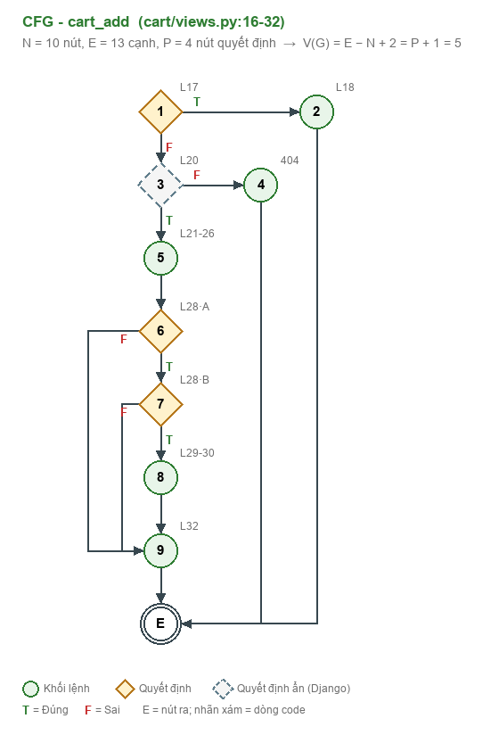
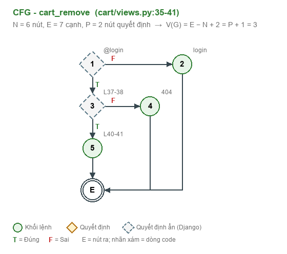
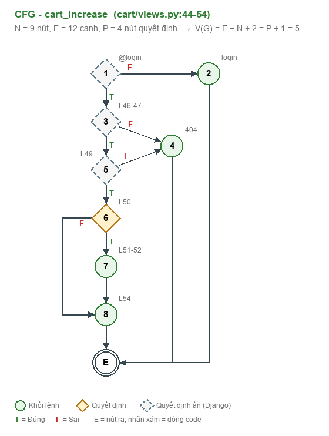
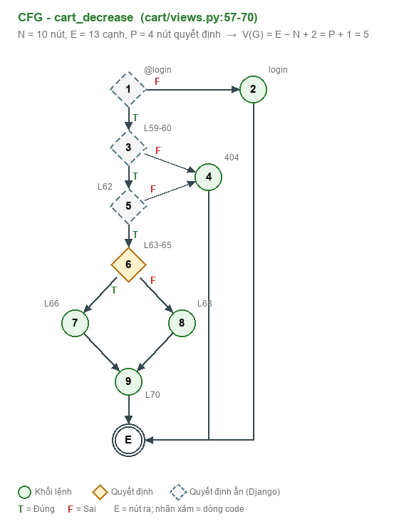
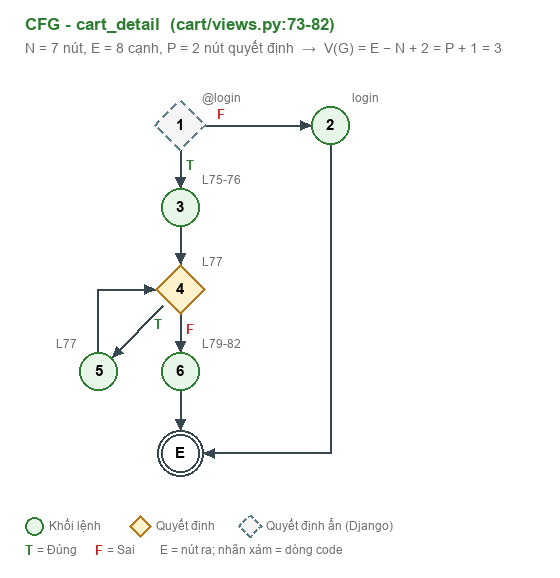
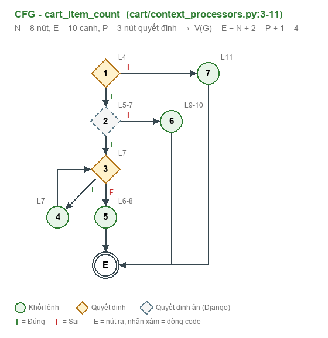
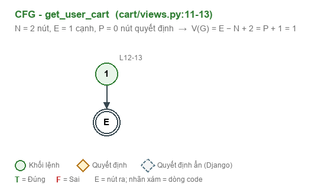

# KIỂM THỬ HỘP TRẮNG – FR3: CFG, PHỦ ĐIỀU KIỆN / MC/DC & KIỂM THỬ VÒNG LẶP

| Thuộc tính | Chi tiết |
| :--- | :--- |
| Phân hệ | Quản lý giỏ hàng (FR3) – `cart/views.py`, `cart/context_processors.py`, `cart/models.py` |
| Người thực hiện | Lê Bá Hoài Phong |
| Mã nguồn kiểm thử | [`cart/tests_whitebox.py`](../cart/tests_whitebox.py) – 49 test |
| Report | Sheet `Phong_CFG_MCDC_Loop` trong [`Report.xlsx`](Report.xlsx) |
| Tạo lại sheet và ảnh CFG | `.venv\Scripts\python.exe tools/build_cart_whitebox_report.py` |
| Kết quả | **49/49 PASS**, độ phủ dòng + nhánh của app `cart`: **100%** (83/83 dòng, 10/10 nhánh) |

---

# PHẦN A. ĐỒ THỊ LUỒNG ĐIỀU KHIỂN (CFG)

## 1. Quy ước

- Hình tròn: khối lệnh. Hình thoi: quyết định. Hình thoi nét đứt: **quyết định ẩn** do Django thực hiện.
- Quyết định ẩn gồm `@login_required`, `get_object_or_404` và ngoại lệ `Cart.DoesNotExist`. Chúng được đưa vào CFG vì mỗi cái tạo ra một đường ra riêng (302 về trang đăng nhập hoặc 404) mà kiểm thử phải đi qua.
- V(G) tính theo 3 cách: `E − N + 2`, `P + 1` (P = số nút quyết định) và số miền. Cả 3 cách cho cùng kết quả.
- Mỗi đường cơ sở có 1 test riêng (`WB-CFG-...`).

## 2. Tổng hợp độ phức tạp Cyclomatic

| Hàm | Vị trí | N | E | P | V(G) | Đường cơ sở | Kết quả |
| :--- | :--- | :---: | :---: | :---: | :---: | :---: | :---: |
| `get_user_cart` | views.py:11-13 | 2 | 1 | 0 | 1 | 1 | 1/1 PASS |
| `cart_add` | views.py:16-32 | 10 | 13 | 4 | 5 | 5 | 5/5 PASS |
| `cart_remove` | views.py:35-41 | 6 | 7 | 2 | 3 | 3 | 3/3 PASS |
| `cart_increase` | views.py:44-54 | 9 | 12 | 4 | 5 | 5 | 5/5 PASS |
| `cart_decrease` | views.py:57-70 | 10 | 13 | 4 | 5 | 5 | 5/5 PASS |
| `cart_detail` | views.py:73-82 | 7 | 8 | 2 | 3 | 3 | 3/3 PASS |
| `cart_item_count` | context_processors.py:3-11 | 8 | 10 | 3 | 4 | 4 | 4/4 PASS |
| `Cart.__str__`, `CartItem.__str__`, `CartItem.total_price` | models.py | 2 | 1 | 0 | 1 mỗi hàm | 3 | 3/3 PASS |
| **Tổng** | **10 hàm** | | | | **29** | **29** | **29/29 PASS** |

## 3. CFG và đường cơ sở từng hàm

### 3.1 `cart_add`



| Mã TC | Đường đi | Điều kiện | Dữ liệu vào | Mong đợi | KQ |
| :--- | :--- | :--- | :--- | :--- | :---: |
| WB-CFG-ADD-P1 | 1 → 2 → E | D1 = T | Khách, `GET /cart/add/{A}/` | 302 về login, không tạo CartItem | PASS |
| WB-CFG-ADD-P2 | 1 → 3 → 4 → E | D1 = F, I2 = F | `GET /cart/add/999999/` | 404 | PASS |
| WB-CFG-ADD-P3 | 1 → 3 → 5 → 6 → 9 → E | A = F (SP mới) | Giỏ chưa có A | q = 1 | PASS |
| WB-CFG-ADD-P4 | 1 → 3 → 5 → 6 → 7 → 8 → 9 → E | A = T, B = T | A×1 | q = 2 | PASS |
| WB-CFG-ADD-P5 | 1 → 3 → 5 → 6 → 7 → 9 → E | A = T, B = F | A×2147483647 | Giữ q = 2147483647 | PASS |

### 3.2 `cart_remove`



| Mã TC | Đường đi | Điều kiện | Dữ liệu vào | Mong đợi | KQ |
| :--- | :--- | :--- | :--- | :--- | :---: |
| WB-CFG-REM-P1 | 1 → 2 → E | I1 = F | Khách | 302 về login | PASS |
| WB-CFG-REM-P2 | 1 → 3 → 4 → E | I2 = F | `GET /cart/remove/999999/` | 404 | PASS |
| WB-CFG-REM-P3 | 1 → 3 → 5 → E | I1 = T, I2 = T | A×5 | 302 về /cart/, A bị xóa | PASS |

Phân tích đường cho thấy EP-12 (SP có trong giỏ) và EP-13 (SP không có trong giỏ) đi **cùng một đường**, vì `filter(...).delete()` không rẽ nhánh.

### 3.3 `cart_increase`



| Mã TC | Đường đi | Điều kiện | Dữ liệu vào | Mong đợi | KQ |
| :--- | :--- | :--- | :--- | :--- | :---: |
| WB-CFG-INC-P1 | 1 → 2 → E | I1 = F | Khách | 302 về login | PASS |
| WB-CFG-INC-P2 | 1 → 3 → 4 → E | I2 = F | `GET /cart/increase/999999/` | 404 | PASS |
| WB-CFG-INC-P3 | 1 → 3 → 5 → 4 → E | I3 = F | Giỏ chưa có A | 404, không tạo CartItem | PASS |
| WB-CFG-INC-P4 | 1 → 3 → 5 → 6 → 7 → 8 → E | D3 = T | A×2 | q = 3 | PASS |
| WB-CFG-INC-P5 | 1 → 3 → 5 → 6 → 8 → E | D3 = F | A×2147483647 | Giữ nguyên q | PASS |

### 3.4 `cart_decrease`



| Mã TC | Đường đi | Điều kiện | Dữ liệu vào | Mong đợi | KQ |
| :--- | :--- | :--- | :--- | :--- | :---: |
| WB-CFG-DEC-P1 | 1 → 2 → E | I1 = F | Khách | 302 về login | PASS |
| WB-CFG-DEC-P2 | 1 → 3 → 4 → E | I2 = F | `GET /cart/decrease/999999/` | 404 | PASS |
| WB-CFG-DEC-P3 | 1 → 3 → 5 → 4 → E | I3 = F | Giỏ chưa có A | 404 | PASS |
| WB-CFG-DEC-P4 | 1 → 3 → 5 → 6 → 7 → 9 → E | D4 = T | A×1 | A bị xóa | PASS |
| WB-CFG-DEC-P5 | 1 → 3 → 5 → 6 → 8 → 9 → E | D4 = F | A×3 | q = 2 | PASS |

### 3.5 `cart_detail`



| Mã TC | Đường đi | Điều kiện | Dữ liệu vào | Mong đợi | KQ |
| :--- | :--- | :--- | :--- | :--- | :---: |
| WB-CFG-DET-P1 | 1 → 2 → E | I1 = F | Khách | 302 về login | PASS |
| WB-CFG-DET-P2 | 1 → 3 → 4 → 6 → E | Vòng lặp 0 lần | Giỏ trống | total_price = 0, hiện giỏ trống | PASS |
| WB-CFG-DET-P3 | 1 → 3 → 4 → 5 → 4 → 6 → E | Vòng lặp 1 lần | A×2 (50.000đ) | total_price = 100.000 | PASS |

### 3.6 `cart_item_count` (context processor)



| Mã TC | Đường đi | Điều kiện | Dữ liệu vào | Mong đợi | KQ |
| :--- | :--- | :--- | :--- | :--- | :---: |
| WB-CFG-CIC-P1 | 1 → 7 → E | D5 = F | Khách | 0 | PASS |
| WB-CFG-CIC-P2 | 1 → 2 → 6 → E | D6 = F (DoesNotExist) | User chưa có Cart | 0, không lỗi 500 | PASS |
| WB-CFG-CIC-P3 | 1 → 2 → 3 → 5 → E | Vòng lặp 0 lần | Cart rỗng | 0 | PASS |
| WB-CFG-CIC-P4 | 1 → 2 → 3 → 4 → 3 → 5 → E | Vòng lặp ≥ 1 lần | A×2, B×3 | 5 | PASS |

### 3.7 `get_user_cart` và các hàm của `models.py`



Các hàm này chỉ có 1 đường (V(G) = 1). Mỗi hàm có 1 test: WB-CFG-GUC-P1, WB-CFG-MOD-P1 → P3. Các ca `__str__` phủ nốt dòng 11 và 23 của `models.py` mà các bộ hộp đen trước đây chưa phủ.

---

# PHẦN B. PHỦ ĐIỀU KIỆN / MC/DC

## 4. Danh sách quyết định

| Mã | Vị trí | Biểu thức | Số điều kiện đơn |
| :---: | :--- | :--- | :---: |
| D1 | views.py:17 | `not request.user.is_authenticated` | 1 |
| D2 | views.py:28 | `not created and cart_item.quantity < MAX_QUANTITY` | **2** |
| D3 | views.py:50 | `cart_item.quantity < MAX_QUANTITY` | 1 |
| D4 | views.py:65 | `cart_item.quantity <= 0` (sau khi trừ 1) | 1 |
| D5 | context_processors.py:4 | `request.user.is_authenticated` | 1 |
| D6 | context_processors.py:5-10 | `try / except Cart.DoesNotExist` | 1 |
| D7 | views.py:77 | Điều kiện vòng lặp L1 | 1 |
| D8 | context_processors.py:7 | Điều kiện vòng lặp L2 | 1 |
| I1 | 4 view | `@login_required` | 1 |
| I2 | views.py:20, 38, 47, 60 | `get_object_or_404(Product)` | 1 |
| I3 | views.py:49, 62 | `get_object_or_404(CartItem)` | 1 |

## 5. MC/DC cho quyết định kép D2 (`views.py:28`)

A = `not created` (SP đã có trong giỏ), B = `quantity < MAX`.

| # | A | B | A and B | Mã TC | Dữ liệu vào | Mong đợi | KQ |
| :---: | :---: | :---: | :---: | :--- | :--- | :--- | :---: |
| 1 | T | T | T | WB-MCDC-D2-01 | A×1 | q = 2 | PASS |
| 1b | T | T (biên MAX − 1) | T | WB-MCDC-D2-04 | A×2147483646 | q = 2147483647 | PASS |
| 2 | T | F | F | WB-MCDC-D2-02 | A×2147483647 | Giữ q | PASS |
| 3 | F | (không đánh giá – ngắn mạch) | F | WB-MCDC-D2-03 | Giỏ chưa có A | q = 1 | PASS |
| 4 | F | F | F | WB-MCDC-D2-05 | — | **Không khả thi**: SP mới luôn có q = 1 < MAX | PASS |

- **A độc lập:** cặp (#1, #3). B giữ T, A đổi từ T sang F thì kết quả đổi từ T sang F.
- **B độc lập:** cặp (#1, #2). A giữ T, B đổi từ T sang F thì kết quả đổi từ T sang F.
- Tập tối thiểu {#1, #2, #3} = n + 1 = 3 ca. Phủ đa điều kiện đạt 3/3 tổ hợp khả thi.

## 6. Các quyết định 1 điều kiện

Mỗi quyết định có 1 ca T và 1 ca F. Ca nào đã có ở phần CFG thì dùng lại; chi tiết xem bảng 2.3 trong sheet. Các ca mới:

| Mã TC | Quyết định | Giá trị | Dữ liệu vào | Mong đợi | KQ |
| :--- | :---: | :--- | :--- | :--- | :---: |
| WB-MCDC-D3-01 | D3 | T (biên MAX − 1) | A×2147483646, tăng | q = 2147483647 | PASS |
| WB-MCDC-D3-02 | D3 | F (biên MAX) | A×2147483647, tăng | Giữ q | PASS |
| WB-MCDC-D4-01 | D4 | T (1 → 0) | A×1, giảm | Xóa A | PASS |
| WB-MCDC-D4-02 | D4 | F (2 → 1) | A×2, giảm | q = 1 | PASS |
| WB-MCDC-D4-03 | D4 | T (0 → −1) | A×0 (dữ liệu bất thường), giảm | Xóa A, không 500 | PASS |
| WB-MCDC-D5-01 | D5 | F | Gọi hàm với `AnonymousUser` | `{'cart_item_count': 0}` | PASS |
| WB-MCDC-D5-02 | D5 | T | Gọi hàm với user có A×4 | `{'cart_item_count': 4}` | PASS |

WB-MCDC-D4-03 kiểm tra đúng toán tử `<=`. Nếu code viết `== 0` thì giá trị −1 sẽ bị lưu, vi phạm ràng buộc `quantity >= 0`.

## 7. Tổng hợp tiêu chí

| Tiêu chí | Kết quả |
| :--- | :--- |
| Phủ quyết định (Decision / Branch) | Đạt – 11 quyết định × 2 = 22/22 kết quả |
| Phủ điều kiện (Condition) | Đạt – 12 điều kiện đơn × 2 = 24/24 giá trị |
| Phủ điều kiện / quyết định (C/DC) | Đạt |
| MC/DC | Đạt |
| Phủ đa điều kiện (MCC) | Đạt – 3/3 tổ hợp khả thi của D2 |

---

# PHẦN C. KIỂM THỬ VÒNG LẶP

## 8. Các vòng lặp

| Mã | Vị trí | Mã nguồn | Loại |
| :---: | :--- | :--- | :--- |
| L1 | views.py:77 | `sum(item.product.price * item.quantity for item in cart_items)` | Vòng lặp đơn |
| L1' | cart/detail.html:32 | `` | Vòng lặp đơn (cùng tập với L1) |
| L2 | context_processors.py:7 | `sum(item.quantity for item in ...items.all())` | Vòng lặp đơn |

Phân hệ không có vòng lặp lồng nhau hay nối tiếp. Số lần lặp = số dòng CartItem. Vì `unique_together (cart, product)`, giới hạn trên **n = số sản phẩm trong hệ thống**. Dữ liệu test tạo đúng n = 10 SP với giá 50.000, 30.000, 20.000, 45.000, 15.000, 25.000, 35.000, 40.000, 55.000, 60.000 (tổng 375.000); SP thứ i có q = i. Mỗi request `GET /cart/` kiểm tra cùng lúc L1, L1' và L2.

## 9. Test case

| Mã TC | Số lần lặp | Mức | Mong đợi (total_price; cart_item_count) | KQ |
| :--- | :---: | :--- | :--- | :---: |
| WB-LOOP-01 | 0 | Bỏ qua vòng lặp | 0; 0; hiện giỏ trống | PASS |
| WB-LOOP-02 | 1 | 1 lần | 50.000; 1 | PASS |
| WB-LOOP-03 | 2 | 2 lần | 110.000; 3 | PASS |
| WB-LOOP-04 | 5 | m lần (điển hình) | 425.000; 15 | PASS |
| WB-LOOP-05 | 9 | n − 1 | 1.635.000; 45 | PASS |
| WB-LOOP-06 | 10 | n (tối đa) | 2.235.000; 55 | PASS |
| WB-LOOP-07 | 10 (thử 11) | n + 1 | Vẫn 10 lần lặp; SP1 lên q = 2; 2.285.000; 56 | PASS |
| WB-LOOP-08 | 10 | n, mỗi q = 2147483647 | 805.306.367.625.000; 21.474.836.470; không 500 | PASS |

---

# PHẦN D. KẾT QUẢ

## 10. Độ phủ (coverage.py `--branch`, app `cart`)

| Phạm vi chạy | Số ca | Kết quả | Độ phủ (dòng + nhánh) |
| :--- | :---: | :--- | :---: |
| Chỉ 33 ca EP/BVA | 33 | 33 PASS | 93,5% |
| EP/BVA + Chuyển trạng thái + BQĐ | 88 | 86 PASS, 2 FAIL (ST-21, ST-22) | 97,8% |
| **Chỉ bộ hộp trắng** | **49** | **49 PASS** | **100%** |
| Toàn bộ app `cart` | 137 | 135 PASS, 2 FAIL (ST-21, ST-22 – BUG-CART-02) | 100% |

## 11. Kiểm tra đột biến (mutation)

Sửa sai 1 chỗ trong code rồi chạy lại bộ hộp trắng. Code được khôi phục sau mỗi lần sửa.

| Mã | Vị trí | Đột biến | Ca phát hiện |
| :---: | :--- | :--- | :--- |
| M1 | views.py:28 | `<` → `<=` | D2-02, ADD-P5 |
| M2 | views.py:28 | Bỏ `not created and` | D2-03, ADD-P3 |
| M3 | views.py:28 | `and` → `or` | D2-02, D2-03, ADD-P3, ADD-P5 |
| M4 | views.py:50 | `<` → `<=` | D3-02, INC-P5 |
| M5 | views.py:65 | `<= 0` → `== 0` | **Chỉ D4-03** – 88 ca hộp đen cũ không phát hiện |
| M6 | views.py:77 | Vòng lặp bỏ phần tử đầu | DET-P3, LOOP-02 → 08 |
| M7 | views.py:77 | Vòng lặp bỏ phần tử cuối | DET-P3, LOOP-02 → 08 |
| M8 | context_processors.py:7 | Đếm số dòng thay vì cộng quantity | CIC-P4, LOOP-03 → 08, D5-02 |
| M9 | context_processors.py:4 | Đảo điều kiện | CIC-P1, CIC-P4, D5-01, D5-02, LOOP-02 → 08 |

9/9 đột biến bị phát hiện.

## 12. Thực thi

```bash
# Chạy test hộp trắng
.venv\Scripts\python.exe manage.py test cart.tests_whitebox -v 2

# Đo độ phủ
.venv\Scripts\python.exe -m coverage run --branch --source=cart --omit="cart/tests*,cart/migrations/*,cart/management/*" manage.py test cart.tests_whitebox
.venv\Scripts\python.exe -m coverage report -m

# Tạo lại sheet Phong_CFG_MCDC_Loop và ảnh CFG (đóng Report.xlsx trước)
.venv\Scripts\python.exe tools/build_cart_whitebox_report.py
```
