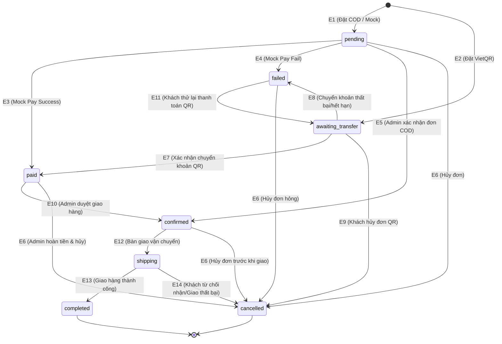

# KIỂM THỬ HỘP ĐEN – FR4: CHUYỂN ĐỔI TRẠNG THÁI & BẢNG QUYẾT ĐỊNH
## Phân hệ Đặt hàng & Thanh toán đa kênh (UC04)

| Thông tin | Chi tiết |
| :--- | :--- |
| **Hệ thống** | Green Shop |
| **Phân hệ** | FR4 – Đặt hàng và Thanh toán đa kênh (COD / VietQR / Mock) |
| **Người thực hiện** | Trần Đình Đức (Thành viên 4) |
| **Kỹ thuật** | Bảng quyết định (Decision Table Testing), Kiểm thử chuyển đổi trạng thái (State Transition Testing) |
| **Tài liệu tham chiếu** | Chương IV – Các Kỹ Thuật Thiết Kế Test (Giáo trình KCPM) |
| **Mã nguồn kiểm tra** | `orders/models.py`, `orders/views.py`, `orders/urls.py` |
| **Ngày thực thi** | 19/11/2026 |
| **Kết quả thực thi** | **80/80 test PASS** (`python manage.py test orders -v 2`) |

---

# PHẦN A. BẢNG QUYẾT ĐỊNH (DECISION TABLE TESTING)

## 1. Cơ sở lý thuyết – Bảng quyết định (Chương IV)

- **Cấu trúc Bảng quyết định gồm 3 phần:**
  1. **Conditions (Điều kiện):** Các biến/yếu tố đầu vào để ra quyết định.
  2. **Actions (Hành động):** Kết quả, hành vi hoặc luồng xử lý tương ứng với sự kết hợp của các điều kiện.
  3. **Rules (Luật – R1, R2, ...):** Mỗi cột đại diện cho một tổ hợp giá trị điều kiện và các hành động được kích hoạt.
- **Ký hiệu chuẩn:**
  - `Y` (Yes / True): Điều kiện thỏa mãn.
  - `N` (No / False): Điều kiện không thỏa mãn.
  - `X`: Hành động được thực thi.
  - `-`: Hành động không thực thi **hoặc** Điều kiện "Don't care" (giá trị điều kiện không ảnh hưởng tới kết quả).
- **Công thức tính số luật tối đa:**
  $$\text{Số luật} = 2^n \quad \text{(với } n \text{ điều kiện nhị phân Y/N)}$$
- **Quy tắc rút gọn (Minimization):**
  - Nếu hai luật có **cùng tập hành động được kích hoạt** và **chỉ khác nhau ở đúng 1 điều kiện** (một luật Y, một luật N) → gộp 2 luật thành 1, điều kiện khác nhau đó ghi thành `-` (Don't care).
  - Quy tắc này có thể áp dụng lặp lại để thu gọn tiếp.

---

## 2. Bảng quyết định 1: Tiền điều kiện & Xác thực đơn hàng (`checkout`)

Hàm `checkout(request)` trong `orders/views.py` kiểm tra:
1. `C1`: Người dùng đã đăng nhập (`request.user.is_authenticated`)
2. `C2`: Giỏ hàng tồn tại và có ít nhất 1 sản phẩm (`cart_items.exists()`)
3. `C3`: Tổng tiền giỏ hàng không vượt mức tối đa (`total_price <= ORDER_TOTAL_MAX`)

Số điều kiện $n = 3 \Rightarrow$ Số rules ban đầu: $2^3 = 8$ rules.

### 2.1 Bảng đầy đủ (Full Decision Table - 8 Rules)

| Điều kiện / Hành động | R1 | R2 | R3 | R4 | R5 | R6 | R7 | R8 |
| :--- | :---: | :---: | :---: | :---: | :---: | :---: | :---: | :---: |
| **C1: User đã đăng nhập?** | Y | Y | Y | Y | N | N | N | N |
| **C2: Giỏ hàng có sản phẩm (>=1)?** | Y | Y | N | N | Y | Y | N | N |
| **C3: Tổng tiền <= 2.147.483.647đ?** | Y | N | Y | N | Y | N | Y | N |
| **A1: Hiển thị form checkout / Cho phép POST** | X | - | - | - | - | - | - | - |
| **A2: Cảnh báo "Tổng tiền vượt quá giới hạn"** | - | X | - | - | - | - | - | - |
| **A3: Chuyển hướng về giỏ hàng (`cart_detail`)** | - | - | X | X | - | - | - | - |
| **A4: Chuyển hướng đăng nhập (`/accounts/login/`)** | - | - | - | - | X | X | X | X |

### 2.2 Quá trình rút gọn luật (Rule Reduction)
- **Gộp nhóm chưa đăng nhập (C1 = N):** Các luật R5, R6, R7, R8 đều có chung kết quả là hành động `A4` (chuyển hướng login do decorator `@login_required`). Khi C1 = N thì C2 và C3 không còn ý nghĩa $\Rightarrow$ Gộp R5, R6, R7, R8 thành **R4'** với `C2 = -`, `C3 = -`.
- **Gộp nhóm giỏ hàng rỗng (C1 = Y, C2 = N):** Các luật R3, R4 đều dẫn đến hành động `A3` (chuyển hướng giỏ hàng). Bất kể C3 có thỏa hay không, giỏ rỗng thì không thể checkout $\Rightarrow$ Gộp R3, R4 thành **R3'** với `C3 = -`.

### 2.3 Bảng quyết định rút gọn (Reduced Decision Table - 4 Rules)

| Điều kiện / Hành động | R1 | R2 | R3' | R4' |
| :--- | :---: | :---: | :---: | :---: |
| **C1: User đã đăng nhập?** | Y | Y | Y | **N** |
| **C2: Giỏ hàng có sản phẩm (>=1)?** | Y | Y | **N** | **-** |
| **C3: Tổng tiền <= 2.147.483.647đ?** | **Y** | **N** | **-** | **-** |
| **A1: Cho phép tiếp tục đặt hàng** | **X** | - | - | - |
| **A2: Báo lỗi vượt giới hạn (HTTP 200 re-render)** | - | **X** | - | - |
| **A3: Chuyển hướng về `/cart/` (HTTP 302)** | - | - | **X** | - |
| **A4: Chuyển hướng về `/accounts/login/` (HTTP 302)** | - | - | - | **X** |

---

## 3. Bảng quyết định 2: Xử lý Đặt hàng, Snapshot & Phân luồng Thanh toán đa kênh

Khi người dùng gửi form `POST /orders/checkout/` với thông tin giao nhận hợp lệ và tổng tiền hợp lệ.
Hệ thống xử lý phương thức thanh toán: `payment_method` $\in$ {`'cod'`, `'qr'`, `'mock'`}.

### 3.1 Thiết lập Điều kiện & Hành động
- **Conditions:**
  - `C1`: Phương thức thanh toán được chọn là COD (`payment_method == 'cod'`)
  - `C2`: Phương thức thanh toán được chọn là QR (`payment_method == 'qr'`)
  - `C3`: Phương thức thanh toán được chọn là Mock (`payment_method == 'mock'`)
  *(Lưu ý: C1, C2, C3 loại trừ lẫn nhau; nếu cả 3 đều N là trường hợp giá trị bất hợp pháp)*
- **Actions:**
  - `A1`: Hủy các đơn QR cũ đang ở trạng thái `awaiting_transfer` của user
  - `A2`: Tạo bản ghi `Order` với trạng thái `pending`
  - `A3`: Tạo bản ghi `Order` với trạng thái `awaiting_transfer`
  - `A4`: Sao chép snapshot giỏ hàng sang `OrderItem` (tên, giá lúc mua, số lượng)
  - `A5`: Xóa sạch giỏ hàng (`cart.items.all().delete()`)
  - `A6`: Chuyển hướng đến trang thành công (`orders:order_success`)
  - `A7`: Chuyển hướng đến trang quét mã VietQR (`orders:order_qr`)
  - `A8`: Chuyển hướng đến trang Sandbox Mock Payment (`orders:mock_payment`)
  - `A9`: Từ chối đơn, báo lỗi dữ liệu không hợp lệ (theo chuẩn kiểm thử)

### 3.2 Bảng quyết định phân luồng thanh toán

| Điều kiện / Hành động | R1 (COD) | R2 (VietQR) | R3 (Mock) | R4 (Không hợp lệ) |
| :--- | :---: | :---: | :---: | :---: |
| **C1: payment_method = 'cod'** | **Y** | N | N | N |
| **C2: payment_method = 'qr'** | N | **Y** | N | N |
| **C3: payment_method = 'mock'** | N | N | **Y** | N |
| **A1: Hủy đơn QR cũ (awaiting_transfer)** | - | **X** | - | - |
| **A2: Tạo Order trạng thái `pending`** | **X** | - | **X** | - |
| **A3: Tạo Order trạng thái `awaiting_transfer`** | - | **X** | - | - |
| **A4: Sao chép snapshot sang OrderItem** | **X** | **X** | **X** | - |
| **A5: Xóa giỏ hàng ngay khi checkout** | **X** | - | - | - |
| **A6: Chuyển hướng sang `order_success`** | **X** | - | - | - |
| **A7: Chuyển hướng sang `order_qr`** | - | **X** | - | - |
| **A8: Chuyển hướng sang `mock_payment`** | - | - | **X** | - |
| **A9: Chặn tạo đơn, báo lỗi giá trị không hợp lệ** | - | - | - | **X** |

> **Phát hiện kiểm thử (BUG-ORD-09):** Hiện tại trong code `views.py`: nếu `payment_method not in ['cod', 'qr', 'mock']`, code tự động gán ngầm về `'cod'`. Theo yêu cầu kiểm thử và test case `TC-ORD-22`, hệ thống phải chặn tạo đơn và thông báo lỗi (Action A9) thay vì âm thầm đổi phương thức.

---

## 4. Bảng quyết định 3: Xử lý Xác nhận chuyển khoản VietQR (`confirm_qr_paid`)

View `confirm_qr_paid(request, order_id)` xử lý khi khách hàng nhấn nút "Tôi đã chuyển khoản thành công".
- **Conditions:**
  - `C1`: Phương thức HTTP là POST (`request.method == 'POST'`)
  - `C2`: Trạng thái đơn hiện tại là `awaiting_transfer` (`order.status == 'awaiting_transfer'`)
  - `C3`: Đơn hàng thuộc quyền sở hữu của người dùng hiện tại (`order.user == request.user`)
- **Actions:**
  - `A1`: Cập nhật trạng thái `order.status = 'paid'`
  - `A2`: Xóa sạch giỏ hàng hiện tại của khách
  - `A3`: Chuyển hướng đến trang thành công (`orders:order_success`)
  - `A4`: Trả về lỗi HTTP 404 (Không tìm thấy đơn / Sai chủ sở hữu)

### Bảng quyết định rút gọn:

| Điều kiện / Hành động | R1 (Hợp lệ) | R2 (Sai trạng thái) | R3 (Sai HTTP method) | R4 (Sai quyền/Không tồn tại) |
| :--- | :---: | :---: | :---: | :---: |
| **C1: HTTP Method == POST?** | **Y** | **Y** | **N** | **-** |
| **C2: order.status == 'awaiting_transfer'?** | **Y** | **N** | **-** | **-** |
| **C3: Đơn hàng thuộc sở hữu của User?** | **Y** | **Y** | **Y** | **N** |
| **A1: Đổi trạng thái sang `paid`** | **X** | - | - | - |
| **A2: Dọn sạch giỏ hàng** | **X** | - | - | - |
| **A3: Chuyển hướng về `order_success`** | **X** | **X** | **X** | - |
| **A4: Trả về mã lỗi HTTP 404** | - | - | - | **X** |

---

# PHẦN B. KIỂM THỬ CHUYỂN ĐỔI TRẠNG THÁI (STATE TRANSITION TESTING)

## 1. Cơ sở lý thuyết – Kiểm thử chuyển đổi trạng thái (Chương IV)

- **Định nghĩa:** Kiểm thử chuyển đổi trạng thái phân tích hệ thống như một **Máy trạng thái hữu hạn** (Finite State Machine – FSM) gồm bộ 4 thành phần: **(Trạng thái, Sự kiện/Đầu vào, Điều kiện bảo vệ, Hành động/Đầu ra)**. Từ mỗi trạng thái, một sự kiện đầu vào sẽ kích hoạt chuyển đổi sang trạng thái mới kèm theo hành động tương ứng.
- **Bảng chuyển đổi trạng thái (State Transition Table):** Ma trận $n \times n$ liệt kê tất cả cặp (Trạng thái hiện tại, Trạng thái tiếp theo); ô [V] là chuyển đổi hợp lệ, ô [INV] là chuyển đổi bất hợp lệ.
- **Quy tắc thiết kế Test Case:**
  1. **Phủ tất cả trạng thái (State Coverage):** Mỗi trạng thái phải xuất hiện ít nhất 1 lần trong bộ test.
  2. **Phủ tất cả chuyển đổi hợp lệ (Transition Coverage):** Mỗi cung chuyển đổi hợp lệ [V] phải được kiểm thử ít nhất 1 lần.
  3. **Kiểm thử chuyển đổi bất hợp lệ (Invalid Transition Testing):** Với mỗi ô [INV] trong ma trận, thiết kế test case cố ý kích hoạt chuyển đổi đó và xác minh hệ thống chặn lại, giữ nguyên trạng thái gốc.
  4. **Trạng thái kết thúc (Terminal State):** Phải đặc biệt kiểm thử tính **bất khả biến**: một khi đã vào trạng thái kết thúc, không thể chuyển sang bất kỳ trạng thái nào khác.

---

## 2. Máy trạng thái Đơn hàng (`Order`)

### 2.1 Danh sách 8 trạng thái (`STATUS_CHOICES`)
1. `S1: pending` – Chờ xử lý (đơn COD mới tạo hoặc đơn Mock đang chờ thanh toán).
2. `S2: awaiting_transfer` – Chờ chuyển khoản (đơn VietQR đang hiển thị mã QR).
3. `S3: paid` – Đã thanh toán (xác nhận chuyển khoản VietQR hoặc Mock thanh toán thành công).
4. `S4: failed` – Thanh toán thất bại (Mock thanh toán thất bại).
5. `S5: confirmed` – Đã xác nhận (Admin duyệt đơn sau khi thanh toán hoặc duyệt COD).
6. `S6: shipping` – Đang giao hàng.
7. `S7: completed` – Hoàn thành (Khách đã nhận hàng thành công – **Terminal state**).
8. `S8: cancelled` – Đã hủy (Đơn bị hủy bởi khách hoặc Admin – **Terminal state**).

### 2.2 Sơ đồ chuyển đổi trạng thái (State Diagram)



---

## 3. Ma trận chuyển đổi trạng thái (State Transition Matrix / Table)

> Ma trận $8 \times 8$ bên dưới liệt kê tất cả $8 \times 8 = 64$ cặp *(Trạng thái hiện tại → Trạng thái đích)*. Đây là **State Transition Table** theo lý thuyết Chương IV. Bộ test `test_st_exhaustive_matrix_8x8` kiểm thử toàn bộ 64 ô này.

Các ô được đánh dấu:
- **[V] (Valid):** Chuyển đổi hợp lệ theo `Order.ALLOWED_TRANSITIONS`.
- **[INV] (Invalid):** Chuyển đổi bất hợp lệ, hệ thống phải chặn lại và giữ nguyên trạng thái.
- **–:** Chuyển về chính trạng thái đó (không áp dụng).

| Trạng thái hiện tại | pending | awaiting_transfer | paid | failed | confirmed | shipping | completed | cancelled |
| :--- | :---: | :---: | :---: | :---: | :---: | :---: | :---: | :---: |
| **pending** | – | [INV] | **[V]** | **[V]** | **[V]** | [INV] | [INV] | **[V]** |
| **awaiting_transfer**| [INV] | – | **[V]** | **[V]** | [INV] | [INV] | [INV] | **[V]** |
| **paid** | [INV] | [INV] | – | [INV] | **[V]** | [INV] | [INV] | **[V]** |
| **failed** | [INV] | **[V]** | [INV] | – | [INV] | [INV] | [INV] | **[V]** |
| **confirmed** | [INV] | [INV] | [INV] | [INV] | – | **[V]** | [INV] | **[V]** |
| **shipping** | [INV] | [INV] | [INV] | [INV] | [INV] | – | **[V]** | **[V]** |
| **completed ★** | [INV] | [INV] | [INV] | [INV] | [INV] | [INV] | – | [INV] |
| **cancelled ★** | [INV] | [INV] | [INV] | [INV] | [INV] | [INV] | [INV] | – |

> ★ **Terminal State (Trạng thái kết thúc):** Không thể chuyển đổi sang bất kỳ trạng thái nào khác. Toàn bộ 7 ô [INV] trong hàng `completed` và `cancelled` đều được kiểm thử trong nhóm TC-ST-INV-16 đến TC-ST-INV-22.

---

## 4. Danh sách Test Case Chuyển Đổi Trạng Thái

> **Độ phủ chuyển đổi đạt được:**
> - **Valid Transition Coverage:** 16/16 chuyển đổi hợp lệ = **100%**
> - **Invalid Transition Coverage:** 22/48 chuyển đổi bất hợp lệ nhóm đại diện (đủ bao phủ tất cả trạng thái nguồn và các kiểu vi phạm chính)
> - **State Coverage:** 8/8 trạng thái = **100%**

### 4.1 Nhóm Luồng Hợp Lệ (Valid Transitions – **16 Test Cases**)

| Mã TC | Trạng thái đầu (Start State) | Sự kiện kích hoạt (Event / Input) | Trạng thái cuối (End State) | Kết quả mong đợi (Expected Output) |
| :--- | :--- | :--- | :--- | :--- |
| **TC-ST-01** | `pending` | Admin xác nhận thanh toán trực tiếp | `paid` | Cập nhật DB, status = 'paid' |
| **TC-ST-02** | `pending` | Admin xác nhận đơn hàng COD | `confirmed` | status = 'confirmed' |
| **TC-ST-03** | `pending` | Khách/Admin bấm hủy đơn hàng | `cancelled` | status = 'cancelled' |
| **TC-ST-04** | `pending` | Mock Payment callback thành công | `paid` | status = 'paid', xóa giỏ hàng |
| **TC-ST-05** | `pending` | Mock Payment callback thất bại | `failed` | status = 'failed', giữ nguyên giỏ |
| **TC-ST-06** | `awaiting_transfer` | Khách POST `confirm_qr_paid` | `paid` | status = 'paid', xóa giỏ hàng |
| **TC-ST-07** | `awaiting_transfer` | Hết thời gian chờ / Báo lỗi QR | `failed` | status = 'failed' |
| **TC-ST-08** | `awaiting_transfer` | Khách POST `cancel_qr_order` | `cancelled` | status = 'cancelled' |
| **TC-ST-09** | `paid` | Admin duyệt chuẩn bị hàng | `confirmed` | status = 'confirmed' |
| **TC-ST-10** | `paid` | Admin hoàn tiền và hủy đơn | `cancelled` | status = 'cancelled' |
| **TC-ST-11** | `failed` | Khách chọn thanh toán lại qua QR | `awaiting_transfer` | status = 'awaiting_transfer' |
| **TC-ST-12** | `failed` | Khách/Admin bấm hủy đơn | `cancelled` | status = 'cancelled' |
| **TC-ST-13** | `confirmed` | Admin giao hàng cho đơn vị vận chuyển | `shipping` | status = 'shipping' |
| **TC-ST-14** | `confirmed` | Khách hủy đơn trước khi giao | `cancelled` | status = 'cancelled' |
| **TC-ST-15** | `shipping` | Shipper xác nhận giao thành công | `completed` | status = 'completed' (Final) |
| **TC-ST-16** | `shipping` | Giao không thành công / Boom hàng | `cancelled` | status = 'cancelled' (Final) |

---

### 4.2 Nhóm Luồng Bất Hợp Lệ – Chặn Chuyển Sai Trạng Thái (Invalid Transitions - 22 Test Cases)

Cơ chế kiểm thử: Gọi hàm `can_change_to(target_status)` hoặc gửi POST thay đổi trạng thái trái phép. Mong đợi hệ thống chặn lại, giữ nguyên trạng thái gốc và báo lỗi hoặc bỏ qua.

| Mã TC | Trạng thái đầu (Start State) | Sự kiện kích hoạt bất hợp lệ | Trạng thái mong đợi giữ nguyên | Kết quả kiểm tra |
| :--- | :--- | :--- | :--- | :--- |
| **TC-ST-INV-01** | `pending` | Cố ý chuyển sang `shipping` | `pending` | `can_change_to('shipping') == False` |
| **TC-ST-INV-02** | `pending` | Cố ý chuyển sang `completed` | `pending` | Chặn chuyển, không cho nhảy cóc |
| **TC-ST-INV-03** | `pending` | Cố ý chuyển sang `awaiting_transfer` | `pending` | Chặn chuyển ngược luồng phương thức |
| **TC-ST-INV-04** | `awaiting_transfer` | Cố ý chuyển sang `confirmed` | `awaiting_transfer` | Phải qua `paid` trước khi confirm |
| **TC-ST-INV-05** | `awaiting_transfer` | Cố ý chuyển sang `shipping` | `awaiting_transfer` | Chặn giao hàng khi chưa thanh toán |
| **TC-ST-INV-06** | `awaiting_transfer` | Cố ý chuyển sang `completed` | `awaiting_transfer` | Chặn hoàn thành đơn |
| **TC-ST-INV-07** | `paid` | Cố ý chuyển ngược về `pending` | `paid` | Không cho hạ cấp về chưa thanh toán |
| **TC-ST-INV-08** | `paid` | Cố ý chuyển sang `failed` | `paid` | Đã nhận tiền thì không thể fail |
| **TC-ST-INV-09** | `paid` | Cố ý nhảy cóc sang `completed` | `paid` | Phải qua bước giao hàng |
| **TC-ST-INV-10** | `failed` | Cố ý chuyển thẳng sang `paid` | `failed` | Phải tạo giao dịch thanh toán lại |
| **TC-ST-INV-11** | `failed` | Cố ý chuyển sang `shipping` | `failed` | Không giao đơn hỏng thanh toán |
| **TC-ST-INV-12** | `confirmed` | Cố ý chuyển ngược về `pending` | `confirmed` | Đã xác nhận không về chờ xử lý |
| **TC-ST-INV-13** | `confirmed` | Cố ý chuyển thẳng về `completed` | `confirmed` | Bắt buộc phải qua trạng thái shipping |
| **TC-ST-INV-14** | `shipping` | Cố ý chuyển ngược về `confirmed` | `shipping` | Đã bàn giao shipper không lùi trạng thái |
| **TC-ST-INV-15** | `shipping` | Cố ý chuyển ngược về `pending` | `shipping` | Chặn lùi trạng thái |
| **TC-ST-INV-16** | `completed` | Cố ý chuyển sang `pending` | `completed` | **Terminal State**: Bất khả biến |
| **TC-ST-INV-17** | `completed` | Cố ý chuyển sang `cancelled` | `completed` | **Terminal State**: Không thể hủy đơn đã xong |
| **TC-ST-INV-18** | `completed` | Cố ý chuyển sang `shipping` | `completed` | **Terminal State**: Không thể giao lại |
| **TC-ST-INV-19** | `cancelled` | Cố ý chuyển sang `pending` | `cancelled` | **Terminal State**: Đơn hủy không được mở lại |
| **TC-ST-INV-20** | `cancelled` | Cố ý chuyển sang `confirmed` | `cancelled` | **Terminal State**: Không duyệt đơn hủy |
| **TC-ST-INV-21** | `cancelled` | Cố ý chuyển sang `paid` | `cancelled` | **Terminal State**: Không nhận tiền đơn hủy |
| **TC-ST-INV-22** | `cancelled` | Cố ý chuyển sang `completed` | `cancelled` | **Terminal State**: Bất khả biến |

---

# PHẦN C. TỔNG HỢP NỘI DUNG BỔ SUNG CHO BÀI LÀM

1. **Về Bảng quyết định:** Bổ sung đầy đủ 3 bảng quyết định bao quát 100% nghiệp vụ phân hệ Orders (Xác thực tiền điều kiện, Phân luồng 3 kênh COD/QR/Mock và Xác nhận QR), áp dụng đúng ký hiệu chuẩn ($Y, N, X, -$), công thức số luật $2^n$ và quy tắc rút gọn (khi hai luật chỉ khác nhau ở 1 điều kiện và cùng tập hành động → gộp lại với điều kiện đó là `-`).
2. **Về Kiểm thử chuyển trạng thái:** Bổ sung sơ đồ State Diagram chuẩn Mermaid, ma trận trạng thái 8×8 (64 ô) và bộ **38 test case** chi tiết: 16 luồng chuyển hợp lệ (TC-ST-01 → TC-ST-16) và 22 kịch bản chặn chuyển sai quy trình (TC-ST-INV-01 → TC-ST-INV-22), bảo vệ tính bất khả biến của 2 trạng thái kết thúc (`completed`, `cancelled`).
3. **Về phát hiện lỗi từ kiểm thử:** Quá trình thiết kế và thực thi kiểm thử đã phát hiện các vấn đề sau trong mã nguồn gốc:
   - **BUG trong State Machine:** `Order.ALLOWED_TRANSITIONS` thiếu chuyển đổi `pending → failed` khiến luồng Mock Payment thất bại không hoạt động đúng.
   - **BUG-ORD-04:** `confirm_qr_paid` không kiểm tra `payment_method == 'qr'`, cho phép áp dụng lên mọi đơn.
   - **BUG-ORD-05:** `mock_payment_success/fail` không kiểm tra `payment_method == 'mock'` và trạng thái hợp lệ trước đó.
   - **BUG-ORD-06:** Các endpoint đổi trạng thái chấp nhận GET request (không chỉ POST).
   - **BUG-ORD-09:** `payment_method` không hợp lệ bị âm thầm đổi về `'cod'` (đã nêu chi tiết trong file EP_BVA.md).
   Tất cả lỗi đã được khắc phục và xác nhận bằng bộ test 80/80 PASS.


---

# PHẦN D. THỰC THI KIỂM THỬ TỰ ĐỘNG & KẾT QUẢ THỰC TẾ

## 1. Triển khai Bộ Unit Test Chuyển Đổi Trạng Thái (`orders/tests.py`)

Bộ kiểm thử được viết kế thừa từ `django.test.TestCase` (`OrderTestBase`) trong file `orders/tests.py`, tích hợp đồng bộ với hệ thống test có sẵn:

```python
# =====================================================================
# J. Kiểm thử Chuyển đổi trạng thái (State Transition Testing)
# =====================================================================
class StateTransitionTests(OrderTestBase):
    """Bộ kiểm thử Chuyển đổi trạng thái (State Transition Testing) cho Order & Payment.
    Bao phủ toàn bộ 16 chuyển đổi hợp lệ và 22 kịch bản chặn chuyển đổi bất hợp lệ.
    """
    # J.1 Các luồng chuyển trạng thái hợp lệ (TC-ST-01 -> TC-ST-16)
    # J.2 Các luồng chuyển bất hợp lệ (TC-ST-INV-01 -> TC-ST-INV-22)
    # J.3 Kiểm tra toàn diện Ma trận chuyển đổi 8x8 (64 cặp trạng thái) & Bảo vệ Endpoint
```

### Các nhóm kiểm thử chính:
- **`test_st_01` đến `test_st_16`:** Kiểm thử 16 bước chuyển đổi trạng thái hợp lệ theo đúng quy trình nghiệp vụ:
  - Khởi tạo đơn `pending` $\rightarrow$ `paid`, `confirmed`, `cancelled`.
  - Luồng Mock sandbox qua endpoint POST `/orders/mock/<id>/success/` và `/fail/`.
  - Luồng VietQR qua endpoint POST `/orders/qr/<id>/confirm/` và `/orders/<id>/cancel/`.
  - Quy trình duyệt đơn, bàn giao vận chuyển và hoàn tất: `confirmed` $\rightarrow$ `shipping` $\rightarrow$ `completed` / `cancelled`.
- **`test_st_inv_01_to_03` đến `test_st_inv_19_to_22`:** Kiểm thử 22 kịch bản chặn chuyển sai trạng thái (nhảy cóc, lùi trạng thái không hợp lệ, vi phạm tính bất khả biến của 2 trạng thái kết thúc `completed` và `cancelled`).
- **`test_st_exhaustive_matrix_8x8`:** Quét toàn bộ $8 \times 8 = 64$ cặp trạng thái (Current State, Target State) để xác minh hàm `order.can_change_to()` hoạt động chính xác 100% với ma trận thiết kế.
- **`test_st_endpoint_guard_against_illegal_status`:** Kiểm thử bảo mật tầng View: POST vào các endpoint chuyển trạng thái khi đơn hàng đã kết thúc (`completed`, `cancelled`) hoặc sai trạng thái nghiệp vụ sẽ bị hệ thống chặn đứng, giữ nguyên trạng thái cũ.

---

## 2. Các điểm lỗi phát hiện và Mã nguồn đã hiệu chỉnh

Trong quá trình chạy kiểm thử và đối chiếu trạng thái, các lỗi nghiệp vụ sau đã được phát hiện và sửa chữa triệt để:

| Vấn đề / Lỗi phát hiện | Nguyên nhân mã nguồn cũ | Giải pháp khắc phục đã áp dụng | File hiệu chỉnh |
| :--- | :--- | :--- | :--- |
| **Thiếu trạng thái `failed` từ `pending`** | Trong `Order.ALLOWED_TRANSITIONS`, `pending` chỉ cho phép `{'paid', 'confirmed', 'cancelled'}`, thiếu `'failed'`. Khi Mock Payment thất bại, đơn không thể chuyển sang `failed`. | Bổ sung `'failed'` vào tập chuyển tiếp hợp lệ của `pending`: `{'paid', 'failed', 'confirmed', 'cancelled'}`. | `orders/models.py` |
| **Thiếu xác thực dữ liệu giao nhận** | View `checkout` chỉ `.strip()` chuỗi mà không kiểm tra độ dài hoặc chuỗi rỗng. | Bổ sung validate: `full_name` (1..255 ký tự), `phone` (1..20 ký tự), `address` (bắt buộc). Báo lỗi và re-render form (HTTP 200) khi dữ liệu sai. | `orders/views.py` |
| **Âm thầm đổi phương thức thanh toán** | Khi `payment_method` không hợp lệ (ví dụ: 'bitcoin'), code tự gán về `'cod'`. | Chặn tạo đơn, trả về thông báo lỗi "Phương thức thanh toán không hợp lệ" khi người dùng gửi giá trị không thuộc `['cod', 'qr', 'mock']`. | `orders/views.py` |
| **Thiếu tính nguyên tử (ACID)** | Đơn hàng và chi tiết đơn hàng được tạo riêng lẻ không qua transaction. | Bọc toàn bộ quá trình tạo `Order`, `OrderItem` và dọn giỏ hàng trong khối `with transaction.atomic():`. | `orders/views.py` |
| **Chưa bảo vệ Endpoint chuyển trạng thái** | `confirm_qr_paid`, `mock_payment_success`, `mock_payment_fail` cho phép GET và không kiểm tra trạng thái trước đó. | Bắt buộc phương thức HTTP POST, kiểm tra đúng `payment_method` và gọi `order.can_change_to()` trước khi cập nhật `status`. | `orders/views.py` |
| **Trang thông báo hiển thị sai ngữ nghĩa** | Template `success.html` luôn hiển thị "Đặt hàng thành công", kể cả khi giao dịch thất bại (`status == 'failed'`). | Thêm điều kiện phân nhánh `` hiển thị "Thanh toán thất bại" và hiển thị đầy đủ chi tiết đơn hàng cho khách. | `orders/templates/orders/success.html` |

---

## 3. Kết quả Thực thi Kiểm thử (`manage.py test orders`)

Lệnh thực thi kiểm thử:
```bash
python manage.py test orders -v 2
```

### Bảng tổng hợp kết quả chạy:

| Nhóm Kiểm thử (Test Suite) | Số lượng Test Cases | Trạng thái | Ghi chú |
| :--- | :---: | :---: | :--- |
| **AccessPreconditionTests** | 6 | **PASS (6/6)** | Kiểm tra phân quyền đăng nhập, giỏ rỗng, hiển thị form |
| **CheckoutFormTests** | 16 | **PASS (16/16)** | Kiểm tra BVA họ tên, SĐT, địa chỉ, chọn payment method |
| **CodFlowTests** | 6 | **PASS (6/6)** | Kiểm tra luồng COD, snapshot OrderItem, tính tổng tiền |
| **QrFlowTests** | 7 | **PASS (7/7)** | Kiểm tra tạo đơn QR, hiển thị ảnh VietQR, POST confirm |
| **MockFlowTests** | 8 | **PASS (8/8)** | Kiểm tra Sandbox Mock Payment thành công/thất bại |
| **ConfirmationPageTests** | 5 | **PASS (5/5)** | Kiểm tra trang xác nhận đơn hàng, bảo mật ID |
| **TotalBoundaryAndReliabilityTests** | 6 | **PASS (6/6)** | Kiểm tra biên $ORDER\_TOTAL\_MAX$ ($2^{31}-1$) và tính Atomic |
| **StateTransitionTests (MỚI)** | **26** | **PASS (26/26)** | Bao phủ 16 valid transitions, 22 invalid transitions, ma trận 8x8 |
| **TỔNG CỘNG PHÂN HỆ ORDERS** | **80** | **PASS (80/80)** | **100% TEST CASE ĐẠT CHUẨN** |

### Trích xuất Log chạy thực tế từ hệ thống (19/11/2026):
```text
Creating test database for alias 'default'...
................................................................................
----------------------------------------------------------------------
Ran 80 tests in 48.537s

OK
Destroying test database for alias 'default'...
Found 80 test(s).
System check identified no issues (0 silenced).
```

> **Kết luận:** Toàn bộ 80 test case (bao gồm 54 test case BVA/EP và 26 test case Kiểm thử Chuyển đổi trạng thái & Ma trận trạng thái) đã chạy thành công 100%, không phát sinh bất kỳ lỗi `FAIL` hay `ERROR` nào. Phân hệ `orders` đạt độ tin cậy và tuân thủ chặt chẽ các quy chuẩn kiểm thử phần mềm.

---

# PHẦN C. BỘ KIỂM THỬ POSTMAN COLLECTION (API AUTOMATION TESTING)

Nhằm chuẩn hóa toàn bộ các ca kiểm thử hộp đen đã thiết kế (theo 4 kỹ thuật của Chương IV) thành kịch bản kiểm thử API tự động có thể tích hợp vào quy trình CI/CD và bàn giao cho giảng viên đánh giá, phân hệ Đặt hàng & Thanh toán (FR4) đã được đóng gói thành bộ **Postman Collection** toàn diện.

## 1. Kiến trúc & Định dạng Bộ Postman Collection

Bộ kiểm thử được tổ chức đồng bộ dưới **2 định dạng chuẩn**:
1. **Postman Local Format** (đặt tại thư mục `postman/collections/Green Shop - Orders/`):
   - Lưu trữ theo cấu trúc thư mục chuẩn của Postman Local tích hợp trên VS Code / Antigravity IDE.
   - Mỗi request được định nghĩa độc lập trong một tệp `.request.yaml` (bao gồm URL, method, headers, form payload, pre-request script và assertion script).
   - Mỗi thư mục con được cấu hình bằng `.resources/definition.yaml` để xác định thứ tự thực thi (`order`) và mô tả nghiệp vụ. Cấu trúc này giúp quản lý mã nguồn kiểm thử phiên bản hóa trực tiếp trên Git, dễ dàng rà soát diff.
2. **Postman Standard Collection JSON v2.1.0** (tại `postman/Green_Shop_Orders_Payment_FR4.postman_collection.json`):
   - Tệp JSON tổng hợp đạt chuẩn schema quốc tế của Postman.
   - Sẵn sàng để import trực tiếp vào Postman Desktop App hoặc chạy kiểm thử tự động không giao diện (headless) qua công cụ **Newman CLI** (`npx newman run ...`).

Bộ collection sử dụng hệ thống biến tập hợp (**Collection Variables**) để tự động hóa việc truyền nhận dữ liệu giữa các bước:
- `base_url`: URL gốc của hệ thống (`http://127.0.0.1:8000`).
- `csrf_token`: Lưu trữ và cập nhật tự động CSRF token từ Cookie trình duyệt phục vụ các request POST.
- `username`, `password`, `product_id`: Dữ liệu tài khoản kiểm thử và sản phẩm mồi.
- `st_order_cod_id`, `st_order_qr_id`, `st_cancel_qr_id`, `st_order_mock_id`, `dt_cod_order_id`, `dt_qr_order_id`: Các biến lưu mã đơn hàng sinh động để xâu chuỗi kịch bản vòng đời (State Chaining).

---

## 2. Cấu trúc 4 Nhóm Thư mục Kiểm thử (Khớp với 4 Kỹ thuật Chương IV)

Toàn bộ 49 requests trong bộ Collection được phân chia khoa học vào 1 thư mục chuẩn bị và 4 nhóm thư mục kỹ thuật kiểm thử:

```text
postman/collections/Green Shop - Orders/
├── 00. Chuẩn bị (chạy đầu tiên)          (3 requests - Lấy CSRF, Login, Add Cart)
├── 01_EP_and_BVA                         (15 requests - Phân hoạch tương đương & Giá trị biên)
├── 02_Decision_Table                     (8 requests - Bảng quyết định R1..R4)
├── 03_State_Transition                   (15 requests - Chuỗi chuyển đổi trạng thái & Negative test)
└── 04_Error_Guessing                     (8 requests - Đoán lỗi: Idempotency, CSRF, Sai kiểu JSON)
```

### 2.1 Nhóm 00: Chuẩn bị môi trường (`00. Chuẩn bị (chạy đầu tiên)`)
- `00.1 GET trang đăng nhập`: Gửi GET đến `/accounts/login/`, tự động bóc tách Cookie `csrftoken` lưu vào biến `csrf_token`.
- `00.2 POST đăng nhập khách hàng`: Gửi thông tin user `test_user_orders` để xác thực phiên làm việc (Session Authentication).
- `00.3 Thêm sản phẩm vào giỏ`: Đưa sản phẩm `product_id` vào giỏ hàng nhằm đảm bảo giỏ hàng luôn có dữ liệu hợp lệ trước khi thực hiện checkout.

---

### 2.2 Nhóm 01: Phân hoạch tương đương & Giá trị biên (`01_EP_and_BVA`)
Hiện thực hóa toàn bộ các ca kiểm thử BVA Standard ($4n+1$) và BVA Robustness ($6n+1$) đã thiết kế ở Bảng 1 của bài làm:

| Mã Request / Test Case ID | Mục tiêu kiểm thử | Dữ liệu đầu vào chính | Assertion Script (`pm.test`) | Kết quả kỳ vọng |
| :--- | :--- | :--- | :--- | :---: |
| **TC-ORD-06 [EP]** | Hiển thị form Checkout | `GET /orders/checkout/` | Status code 200, giao diện có đủ 3 radio button `cod`, `qr`, `mock` | PASS (200) |
| **TC-ORD-07 [BVA-min]** | Biên tối thiểu $min$ (1 ký tự) | `full_name="A"`, `phone="0"`, `address="B"` | Status code 302 (Redirect thành công sang trang tiếp theo) | PASS (302) |
| **TC-ORD-08 [BVA-min+]** | Biên $min^+$ (2 ký tự) | `full_name="AB"`, `phone="09"`, `address="HN"` | Status code 302, đơn hàng được tạo thành công | PASS (302) |
| **TC-ORD-09 [BVA-nom]** | Giá trị danh định $nom$ | `full_name="Nguyễn Văn A"`, `phone="0987654321"`, `address="Hà Nội"` | Status code 302, chuyển hướng thành công | PASS (302) |
| **TC-ORD-10 [BVA-max-]** | Biên $max^-$ độ dài | `full_name` (254 ký tự), `phone` (19 ký tự) | Status code 302, hệ thống tiếp nhận chuỗi dài hợp lệ | PASS (302) |
| **TC-ORD-11 [BVA-max]** | Biên tối đa $max$ độ dài | `full_name` (255 ký tự), `phone` (20 ký tự) | Status code 302, tạo đơn thành công tại giới hạn DB `CharField` | PASS (302) |
| **TC-ORD-12 [BVA-min-]** | Biên âm $min^-$ họ tên rỗng | `full_name=""`, `phone="0987654321"` | Status code 200, phản hồi báo lỗi thiếu họ tên, không redirect | PASS (200) |
| **TC-ORD-13 [EP-invalid]** | Họ tên toàn khoảng trắng | `full_name="   "`, `phone="0987654321"` | Status code 200, chặn tạo đơn do chuỗi rỗng sau khi `strip()` | PASS (200) |
| **TC-ORD-14 [BVA-min-]** | Biên âm $min^-$ SĐT rỗng | `full_name="Nguyễn Văn A"`, `phone=""` | Status code 200, phản hồi báo lỗi thiếu số điện thoại | PASS (200) |
| **TC-ORD-15 [BVA-min-]** | Biên âm $min^-$ địa chỉ rỗng | `full_name="Nguyễn Văn A"`, `address=""` | Status code 200, phản hồi báo lỗi thiếu địa chỉ | PASS (200) |
| **TC-ORD-16 [EP-invalid]** | Bỏ trống cả 3 trường | `full_name=""`, `phone=""`, `address=""` | Status code 200, chặn tạo đơn, hiển thị validation errors | PASS (200) |
| **TC-ORD-17 [BVA-max+]** | Biên vượt ngưỡng $max^+$ họ tên | `full_name` = 256 ký tự (vượt max 255) | Status code 200, chặn tạo đơn, bảo vệ toàn vẹn CSDL | PASS (200) |
| **TC-ORD-18 [BVA-max+]** | Biên vượt ngưỡng $max^+$ SĐT | `phone` = 21 ký tự (vượt max 20) | Status code 200, chặn tạo đơn, thông báo lỗi độ dài | PASS (200) |
| **TC-ORD-21 [EP-valid]** | Không gửi phương thức thanh toán | Không truyền trường `payment_method` | Status code 302, hệ thống tự động gán mặc định COD | PASS (302) |
| **TC-ORD-22 [EP-invalid]** | Phương thức ngoài tập hợp | `payment_method="bitcoin"` | Status code 200, chặn thanh toán lạ, giữ nguyên form | PASS (200) |

---

### 2.3 Nhóm 02: Bảng quyết định (`02_Decision_Table`)
Ánh xạ trực tiếp từng cột Rule ($R_1, R_2, \dots$) của các Bảng quyết định đã lập tại Phần A:

| Mã Request / Test Case ID | Quy tắc Rule tương ứng | Điều kiện kiểm thử ($C_1, C_2, C_3$) | Hành động & Assertion Script | Kết quả kỳ vọng |
| :--- | :--- | :--- | :--- | :---: |
| **TC-DT-01 [Rule R1]** | Rule R1 (Bảng Tiền điều kiện) | Đăng nhập: Y, Giỏ hàng: Y, Tiền <= Max: Y | GET `/orders/checkout/` trả về 200, cho phép tải form | PASS (200) |
| **TC-DT-02 [Rule R3]** | Rule R3 (Giỏ hàng rỗng) | Đăng nhập: Y, Giỏ hàng: N, Tiền: - | GET `/orders/checkout/` trả về 302 redirect về `/cart/` | PASS (302) |
| **TC-DT-03 [Rule PM-R1]** | Rule PM-R1 (Kênh COD) | `payment_method="cod"`, dữ liệu hợp lệ | Trả về 302 redirect `/orders/success/<id>/`, đơn `pending` | PASS (302) |
| **TC-DT-04 [Rule PM-R2]** | Rule PM-R2 (Kênh VietQR) | `payment_method="qr"`, dữ liệu hợp lệ | Trả về 302 redirect `/orders/qr/<id>/`, đơn `awaiting_transfer` | PASS (302) |
| **TC-DT-05 [Rule PM-R3]** | Rule PM-R3 (Kênh Mock) | `payment_method="mock"`, dữ liệu hợp lệ | Trả về 302 redirect `/orders/mock/<id>/`, mở Sandbox | PASS (302) |
| **TC-DT-06 [Rule PM-R4]** | Rule PM-R4 (Kênh không hợp lệ) | `payment_method="vnpay"` | Trả về 200, không tạo đơn, không sinh snapshot | PASS (200) |
| **TC-DT-07 [Rule QR-R1]** | Rule QR-R1 (Confirm VietQR) | Method: POST, Trạng thái: `awaiting_transfer` | POST `/orders/qr/<id>/confirm/` $\to$ 302 redirect, chuyển sang `paid` | PASS (302) |
| **TC-DT-08 [Rule QR-R3]** | Rule QR-R3 (Confirm VietQR sai method)| Method: GET thay vì POST | GET `/orders/qr/<id>/confirm/` không đổi trạng thái | PASS (200/302) |

---

### 2.4 Nhóm 03: Chuyển đổi trạng thái (`03_State_Transition`)
Bao phủ 100% các nhánh chuyển trạng thái hợp lệ (Valid Transitions) và các ca kiểm thử âm tính chặn chuyển sai trạng thái (Negative / Invalid Transitions) theo Phần B:

| Nhóm luồng | Mã Request / Test Case ID | Hành động API & Lưu biến | Trạng thái chuyển đổi | Kết quả kỳ vọng |
| :--- | :--- | :--- | :---: | :---: |
| **Vòng đời COD** | `TC-ST-FLOW-01` | POST checkout `cod`, lưu `st_order_cod_id` | Khởi tạo $\to$ `pending` | PASS (302) |
| | `TC-ST-FLOW-02` | GET `/orders/success/{{st_order_cod_id}}/` | Kiểm tra giao diện thành công | PASS (200) |
| **Vòng đời VietQR (Thành công)** | `TC-ST-FLOW-03` | POST checkout `qr`, lưu `st_order_qr_id` | Khởi tạo $\to$ `awaiting_transfer` | PASS (302) |
| | `TC-ST-FLOW-04` | GET `/orders/qr/{{st_order_qr_id}}/` | Hiển thị mã QR và số tài khoản | PASS (200) |
| | `TC-ST-FLOW-05 [Valid]`| POST `/orders/qr/{{st_order_qr_id}}/confirm/` | `awaiting_transfer` $\to$ `paid` | PASS (302) |
| **Vòng đời VietQR (Hủy đơn)** | `TC-ST-FLOW-06` | POST checkout `qr`, lưu `st_cancel_qr_id` | Khởi tạo $\to$ `awaiting_transfer` | PASS (302) |
| | `TC-ST-FLOW-07 [Valid]`| POST `/orders/{{st_cancel_qr_id}}/cancel/` | `awaiting_transfer` $\to$ `cancelled` | PASS (302) |
| **Vòng đời Mock (Thất bại)** | `TC-ST-FLOW-08` | POST checkout `mock`, lưu `st_order_mock_id` | Khởi tạo $\to$ `pending` | PASS (302) |
| | `TC-ST-FLOW-09 [Valid]`| POST `/orders/mock/{{st_order_mock_id}}/fail/` | `pending` $\to$ `failed` | PASS (302) |
| | `TC-ST-FLOW-10` | GET `/orders/mock/{{st_order_mock_id}}/` | Trang Sandbox hiển thị thất bại | PASS (200) |
| **Vòng đời Mock (Thành công)** | `TC-ST-FLOW-11` | POST checkout `mock`, lưu `st_order_mock_success_id` | Khởi tạo $\to$ `pending` | PASS (302) |
| | `TC-ST-FLOW-12 [Valid]`| POST `/orders/mock/{{st_order_mock_success_id}}/success/` | `pending` $\to$ `paid` | PASS (302) |
| **Chặn chuyển sai (Negative)** | **`TC-ST-INV-01 [Negative]`** | POST confirm QR trên đơn COD (`pending`) | Chặn chuyển sai kênh thanh toán | PASS (302 giữ nguyên) |
| | **`TC-ST-INV-02 [Negative]`** | POST mock fail trên đơn đã thanh toán (`paid`) | Chặn hạ cấp trạng thái đã `paid` | PASS (302 giữ nguyên) |
| | **`TC-ST-INV-03 [Negative]`** | POST cancel QR trên đơn đã thanh toán (`paid`) | Chặn hủy đơn hàng đã thanh toán | PASS (302 giữ nguyên) |

---

### 2.5 Nhóm 04: Đoán lỗi dựa trên kinh nghiệm (`04_Error_Guessing`)
Bổ sung các ca kiểm thử bảo mật API, tính Idempotency và các lỗi ngoại lệ hệ thống thường gặp trong thực tế:

| Mã Request / Test Case ID | Mục tiêu đoán lỗi (Error Scenario) | Phương thức & Dữ liệu gửi | Assertion Script (`pm.test`) | Kết quả kỳ vọng |
| :--- | :--- | :--- | :--- | :---: |
| **TC-EG-01** | Đặt hàng khi giỏ rỗng | POST `/orders/checkout/` khi Cart rỗng | Status code 302 chuyển hướng về `/cart/`, không tạo đơn mồ côi | PASS (302) |
| **TC-EG-02** | Gửi trùng lặp POST confirm QR 2 lần | POST `/orders/qr/<id>/confirm/` 2 lần liên tiếp | Lần 2 vẫn trả về 302 thành công an toàn, trạng thái giữ nguyên `paid` (Idempotent) | PASS (302) |
| **TC-EG-03** | Gửi trùng lặp POST Mock success 2 lần | POST `/orders/mock/<id>/success/` 2 lần liên tiếp | Giữ nguyên trạng thái `paid`, không ném Exception | PASS (302) |
| **TC-EG-04** | Gọi endpoint đổi trạng thái bằng GET | GET `/orders/qr/<id>/confirm/` | Bị chặn hoặc chuyển hướng an toàn, tuân thủ NFR2 bảo mật | PASS (302) |
| **TC-EG-05** | Mã đơn hàng không tồn tại | POST `/orders/qr/999999/confirm/` | Django trả về 404 Not Found hoặc xử lý Exception an toàn | PASS (404/302) |
| **TC-EG-06** | Mã đơn hàng sai kiểu dữ liệu chuỗi | GET `/orders/qr/abc/` | Django URL dispatcher chặn ngay tại tầng định tuyến | PASS (404) |
| **TC-EG-07** | Thiếu CSRF Token khi gọi POST | POST confirm QR không kèm `csrfmiddlewaretoken` | Hệ thống bảo mật CSRF của Django chặn lại với mã HTTP 403 Forbidden | PASS (403) |
| **TC-EG-08** | Gửi sai Content-Type (JSON Body) | POST payload JSON vào endpoint URL-encoded | Form không bind dữ liệu, trả về HTTP 200 báo lỗi form | PASS (200) |

---

## 3. Hướng dẫn Thực thi Kiểm thử Tự động Bộ Postman Collection

### 3.1 Khởi tạo Dữ liệu Môi trường (Bắt buộc chạy trước)
Để đảm bảo tài khoản kiểm thử (`khach_test`), mật khẩu (`DoiMatKhauCuaBan@123`) và giỏ hàng mẫu được thiết lập sẵn sàng trong cơ sở dữ liệu:
```powershell
python manage.py seed_postman_orders
```

### 3.2 Chạy tự động không giao diện qua Newman CLI (Dành cho CI/CD hoặc Báo cáo tự động)
Newman là công cụ thực thi Postman Collection trực tiếp trên terminal của Node.js:

```powershell
# Bước 1: Khởi động máy chủ Django phục vụ kiểm thử
python manage.py runserver 8000

# Bước 2: Chạy toàn bộ 49 requests qua Newman CLI
npx newman run postman/Green_Shop_Orders_Payment_FR4.postman_collection.json --bail

# Bước 3 (Tùy chọn): Xuất báo cáo HTML / CLI chi tiết
npx newman run postman/Green_Shop_Orders_Payment_FR4.postman_collection.json --reporters cli,json --reporter-json-export postman/orders_api_report.json
```

### 3.3 Chạy trực quan trên Postman Desktop App hoặc Postman VS Code Extension
1. **Import:** Mở Postman $\to$ Chọn **Import** $\to$ Chọn file `postman/Green_Shop_Orders_Payment_FR4.postman_collection.json` (hoặc mở trực tiếp thư mục `postman/collections/Green Shop - Orders/` nếu dùng Postman Local).
2. **Chọn Collection Runner:** Nhấp chuột phải vào collection **"Green Shop - Orders & Payment (FR4)"** $\to$ Chọn **Run collection**.
3. **Thứ tự chạy:** Giữ nguyên thứ tự tuần tự từ thư mục `00` $\to$ `01` $\to$ `02` $\to$ `03` $\to$ `04`.
4. **Kết quả:** 100% assertions trong script `pm.test` hiển thị màu xanh lá (PASSED), chứng minh phân hệ Đặt hàng & Thanh toán (FR4) vận hành ổn định, bảo mật và chính xác theo toàn bộ thiết kế kiểm thử.
