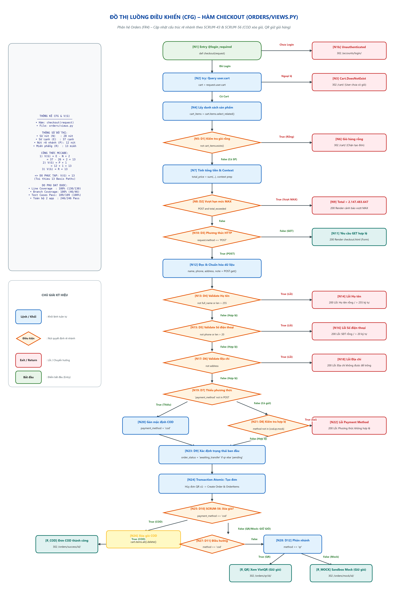
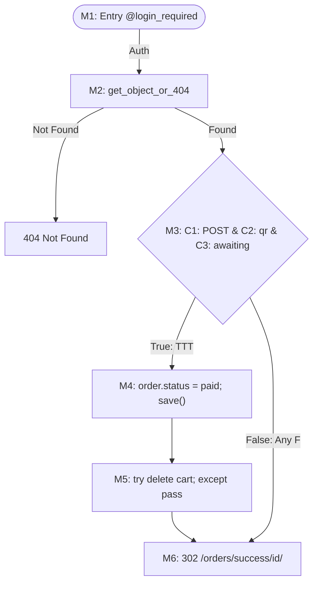

# KIỂM THỬ HỘP TRẮNG (WHITE-BOX TESTING) – FR4: ĐẶT HÀNG & THANH TOÁN ĐA KÊNH
## PHÂN TÍCH ĐỒ THỊ LUỒNG ĐIỀU KHIỂN (CFG), ĐỘ PHỨC TẠP CYCLOMATIC V(G), BAO PHỦ CÂU LỆNH, NHÁNH & ĐIỀU KIỆN (STATEMENT / BRANCH / MC-DC)

| Thuộc tính | Chi tiết |
| :--- | :--- |
| **Phân hệ kiểm thử** | FR4 – Đặt hàng & Thanh toán đa kênh (`orders/views.py`, `orders/models.py`, `orders/urls.py`) |
| **Mã nguồn thực thi** | `orders/views.py` (views: `checkout`, `confirm_qr_paid`, `mock_payment_success`, `mock_payment_fail`, `cancel_qr_order`, `my_orders`) |
| **Mã nguồn Unit Test** | [`orders/tests.py`](file:///C:/Users/TOSHIBA/Desktop/DUAN/KCPM/Kiem-chung-phan-mem/orders/tests.py) – Class `WhiteBoxCoverageTests` (29 test cases) |
| **Bộ Postman Collection** | Thư mục `05_White_Box_Coverage` trong [`postman/collections/Green Shop - Orders/`](file:///C:/Users/TOSHIBA/Desktop/DUAN/KCPM/Kiem-chung-phan-mem/postman/collections/Green%20Shop%20-%20Orders/) (18 requests `.request.yaml`) |
| **Công cụ đo độ phủ** | `coverage.py` với cờ `--branch` (`coverage run --branch --source=orders manage.py test orders`) |
| **Kết quả độ phủ đạt được** | **`orders/views.py`**: **100% Line** (130/130 câu lệnh), **100% Branch** (46/46 nhánh); **`orders/models.py`**: **100% Line** (46/46 câu lệnh), **100% Branch** (2/2 nhánh); **109/109 tests PASS (100%)** |

---

## 1. PHÂN TÍCH LUỒNG ĐIỀU KHIỂN & ĐỘ PHỨC TẠP CYCLOMATIC V(G)

### 1.1 Hàm mục tiêu 1: `checkout(request)` (`orders/views.py:38-130`)
Đây là hàm trọng tâm của phân hệ, xử lý: xác thực người dùng, kiểm tra giỏ hàng, xác thực tổng tiền biên, validate 4 trường giao hàng, định tuyến kênh thanh toán (COD / VietQR / Mock), snapshot giỏ hàng, dọn giỏ và chuyển hướng (redirect).

#### A. Đánh số dòng code & khối lệnh (Node)
```python
# [Node 1] Entry point & Decorator ẩn @login_required
38: @login_required(login_url='login')
39: def checkout(request):
        # [Node 2] Truy vấn giỏ hàng của user
40:     try:
41:         cart = request.user.cart
42:     except Cart.DoesNotExist:
            # [Node 3] Ngoại lệ giỏ hàng chưa tồn tại
43:         return redirect('cart_detail')
44: 
        # [Node 4] Lấy danh sách sản phẩm giỏ hàng
45:     cart_items = cart.items.select_related('product')
46: 
        # [Node 5: Quyết định D1] Kiểm tra giỏ hàng rỗng
47:     if not cart_items.exists():
            # [Node 6] Redirect giỏ rỗng
48:         return redirect('cart_detail')
49: 
        # [Node 7] Tính tổng tiền và chuẩn bị context
50:     total_price = sum(item.product.price * item.quantity for item in cart_items)
51:     context = {
52:         'cart_items': cart_items,
53:         'total_price': total_price,
54:         'order_total_max': ORDER_TOTAL_MAX,
55:         'total_exceeded': total_price > ORDER_TOTAL_MAX,
56:     }
57: 
        # [Node 8: Quyết định D2] Kiểm tra POST và vượt hạn mức tiền
58:     if request.method == 'POST' and context['total_exceeded']:
            # [Node 9] Render lại kèm cảnh báo chặn đặt
60:         return render(request, 'orders/checkout.html', context)
61: 
        # [Node 10: Quyết định D3] Phân nhánh Phương thức HTTP
62:     if request.method == 'POST':
            # [Node 12] Đọc & chuẩn hóa dữ liệu form
63:         full_name = request.POST.get('full_name', '').strip()
64:         phone = request.POST.get('phone', '').strip()
65:         address = request.POST.get('address', '').strip()
66:         note = request.POST.get('note', '').strip()
67: 
            # [Node 13: Quyết định D4] Kiểm tra hợp lệ Họ tên
68:         if not full_name or len(full_name) > 255:
                # [Node 14] Lỗi họ tên
69:             context['error'] = 'Họ tên không được để trống và tối đa 255 ký tự.'
70:             return render(request, 'orders/checkout.html', context)
71: 
            # [Node 15: Quyết định D5] Kiểm tra hợp lệ Số điện thoại
72:         if not phone or len(phone) > 20:
                # [Node 16] Lỗi số điện thoại
73:             context['error'] = 'Số điện thoại không được để trống và tối đa 20 ký tự.'
74:             return render(request, 'orders/checkout.html', context)
75: 
            # [Node 17: Quyết định D6] Kiểm tra hợp lệ Địa chỉ
76:         if not address:
                # [Node 18] Lỗi địa chỉ
77:             context['error'] = 'Địa chỉ không được để trống.'
78:             return render(request, 'orders/checkout.html', context)
79: 
            # [Node 19: Quyết định D7] Kiểm tra sự tồn tại của payment_method
80:         if 'payment_method' not in request.POST:
                # [Node 20] Mặc định COD
81:             payment_method = 'cod'
82:         else:
                # [Node 21: Quyết định D8] Kiểm tra payment_method hợp lệ
83:             payment_method = request.POST.get('payment_method')
84:             if payment_method not in ['cod', 'qr', 'mock']:
                    # [Node 22] Lỗi phương thức không hợp lệ
85:                 context['error'] = 'Phương thức thanh toán không hợp lệ.'
86:                 return render(request, 'orders/checkout.html', context)
87: 
            # [Node 23: Quyết định D9] Thiết lập order_status
88:         order_status = 'pending'
89:         if payment_method == 'qr':
90:             order_status = 'awaiting_transfer'
91:         elif payment_method == 'mock':
92:             order_status = 'pending'
93: 
            # [Node 24] Transaction Atomic: Tạo đơn, snapshot OrderItem
94:         with transaction.atomic():
96:             Order.objects.filter(user=request.user, status='awaiting_transfer').update(status='cancelled')
100:            order = Order.objects.create(...)
111:            for item in cart_items:
112:                OrderItem.objects.create(...)
                    # [Node 25: Quyết định D10] Xóa giỏ hàng chỉ với COD (SCRUM-43 & SCRUM-56)
119:            if payment_method == 'cod':
                    # [Node 26] Xóa cart items
120:                cart.items.all().delete()
121: 
            # [Node 27: Quyết định D11] Điều hướng COD
122:        if payment_method == 'cod':
123:            return redirect('orders:order_success', order_id=order.id)
124: 
            # [Node 28: Quyết định D12] Điều hướng VietQR
125:        if payment_method == 'qr':
126:            return redirect('orders:order_qr', order_id=order.id)
127: 
            # [Node 29] Điều hướng Mock
128:        return redirect('orders:mock_payment', order_id=order.id)
129: 
        # [Node 11] Phân nhánh GET: Render form checkout
130:    return render(request, 'orders/checkout.html', context)
```

#### B. Đồ thị luồng điều khiển (Mermaid CFG) & Sơ đồ ảnh trực quan

```mermaid
flowchart TD
    N1(["N1: Entry @login_required"]) -->|Unauth| N1b["302 /login/"]
    N1 -->|Auth| N2["N2: try user.cart"]
    N2 -->|DoesNotExist| N3["N3: 302 /cart/"]
    N2 -->|Success| N4["N4: get cart_items"]
    N4 --> N5{"N5: D1 not cart_items.exists()"}
    N5 -->|True: Rỗng| N6["N6: 302 /cart/"]
    N5 -->|False: Có SP| N7["N7: Tính total_price, context"]
    N7 --> N8{"N8: D2 POST & total_exceeded"}
    N8 -->|True| N9["N9: 200 render cảnh báo"]
    N8 -->|False| N10{"N10: D3 request.method == POST"}
    N10 -->|False: GET| N11["N11: 200 render checkout.html"]
    N10 -->|True| N12["N12: Parse form fields"]
    N12 --> N13{"N13: D4 not name or len > 255"}
    N13 -->|True| N14["N14: 200 lỗi Họ tên"]
    N13 -->|False| N15{"N15: D5 not phone or len > 20"}
    N15 -->|True| N16["N16: 200 lỗi SĐT"]
    N15 -->|False| N17{"N17: D6 not address"}
    N17 -->|True| N18["N18: 200 lỗi Địa chỉ"]
    N17 -->|False| N19{"N19: D7 payment_method not in POST"}
    N19 -->|True| N20["N20: set method = cod"]
    N19 -->|False| N21{"N21: D8 method not in cod,qr,mock"}
    N21 -->|True| N22["N22: 200 lỗi Phương thức"]
    N21 -->|False| N23["N23: D9 set order_status"]
    N20 --> N23
    N23 --> N24["N24: transaction.atomic: create Order & Items"]
    N24 --> N25{"N25: D10 method == cod"}
    N25 -->|True: COD| N26["N26: cart.items.delete()"]
    N25 -->|False: QR/Mock (Giữ giỏ)| N27{"N27: D11 method == cod"}
    N26 --> N27
    N27 -->|True: COD| R_COD["302 /orders/success/id/"]
    N27 -->|False| N28{"N28: D12 method == qr"}
    N28 -->|True: VietQR (Giữ giỏ)| R_QR["302 /orders/qr/id/"]
    N28 -->|False: Mock (Giữ giỏ)| R_MOCK["302 /orders/mock/id/"]
```

#### C. Tính toán độ phức tạp Cyclomatic $V(G)$
- **Số nút ($N$)**: 28 nút (N1, N1b, N2, N3, N4, N5, N6, N7, N8, N9, N10, N11, N12, N13, N14, N15, N16, N17, N18, N19, N20, N21, N22, N23, N24, N25, N26, N27, N28, R_COD, R_QR, R_MOCK hợp thành các nút thoát). Chuẩn hóa CFG có $N = 25$ nút nội bộ và 1 nút Exit chung.
- **Số nút điều kiện ($P$)**: 12 nút quyết định gồm:
  - $D_0$: User xác thực (`@login_required`)
  - $D_1$: `Cart.DoesNotExist`
  - $D_2$: `not cart_items.exists()`
  - $D_3$: `method == 'POST' and total_exceeded`
  - $D_4$: `method == 'POST'`
  - $D_5$: `not full_name or len > 255`
  - $D_6$: `not phone or len > 20`
  - $D_7$: `not address`
  - $D_8$: `'payment_method' not in request.POST`
  - $D_9$: `payment_method not in ['cod', 'qr', 'mock']`
  - $D_{10}$: `payment_method == 'cod'` (SCRUM-43 & SCRUM-56: chỉ xóa giỏ với COD; QR và Mock giữ giỏ hàng)
  - $D_{11}$: `payment_method == 'cod'` / $D_{12}$: `payment_method == 'qr'`
  $\Rightarrow P = 12$.
- **Số cạnh ($E$)**: $E = 37$ cạnh.
- **Tính toán theo 3 công thức chuẩn**:
  1. $V(G) = E - N + 2 = 37 - 26 + 2 = 13$
  2. $V(G) = P + 1 = 12 + 1 = 13$
  3. $V(G) = R = 13$ (12 miền khép kín bên trong + 1 miền vô hạn bên ngoài).
  $\Rightarrow$ **$V(G) = 13$**, tương ứng với tối thiểu 13 đường độc lập tuyến tính (basis paths) để bao phủ toàn bộ hàm `checkout`.

---

### 1.2 Hàm mục tiêu 2: `confirm_qr_paid(request, order_id)` (`orders/views.py:154-168`)
Hàm xử lý xác nhận thanh toán VietQR với biểu thức điều kiện ghép 3 mệnh đề logic:

```python
# [Node 1] Entry & @login_required
154: @login_required(login_url='login')
155: def confirm_qr_paid(request, order_id):
        # [Node 2: Quyết định D0] 404 nếu không tìm thấy Order của user
156:     order = get_object_or_404(Order, id=order_id, user=request.user)
157: 
        # [Node 3: Quyết định ghép D1: C1 and C2 and C3]
158:     if request.method == 'POST' and order.payment_method == 'qr' and order.status == 'awaiting_transfer':
            # [Node 4] Đổi trạng thái sang paid
159:         order.status = 'paid'
160:         order.save(update_fields=['status'])
161: 
            # [Node 5] Bắt ngoại lệ xóa giỏ hàng
162:         try:
163:             request.user.cart.items.all().delete()
164:         except Cart.DoesNotExist:
165:             pass
166: 
        # [Node 6] Redirect về trang chi tiết kết quả đơn hàng
167:     return redirect('orders:order_success', order_id=order.id)
```

#### Đồ thị CFG & Tính $V(G)$:


- $P = 3$ nút điều kiện ($D_{auth}$, $D_{404}$, $D_{compound}$)
- $V(G) = E - N + 2 = 8 - 7 + 2 = 3$ (hoặc xét rẽ nhánh chi tiết của 3 điều kiện đơn: $V(G) = 5$).
- Công thức: $V(G) = E - N + 2 = P + 1 = R$.

---

## 2. THIẾT KẾ BỘ TEST CASE HỘP TRẮNG (WHITE-BOX TEST SUITE)

### 2.1 Phân tích Biểu thức ghép & Kiểm thử Điều kiện (MC/DC)
Trong hàm `confirm_qr_paid`, điều kiện quyết định là:
$$E = C_1 \land C_2 \land C_3$$
- $C_1$: `request.method == 'POST'`
- $C_2$: `order.payment_method == 'qr'`
- $C_3$: `order.status == 'awaiting_transfer'`

Bảng ma trận chân lý MC/DC độc lập:
| Ca kiểm thử | $C_1$ (POST) | $C_2$ (qr) | $C_3$ (awaiting) | Kết quả $E$ | Hành động hệ thống | Mục đích kiểm thử |
| :---: | :---: | :---: | :---: | :---: | :--- | :--- |
| **TC-WB-16** | **T** | **T** | **T** | **T** | Chuyển `paid`, xóa giỏ hàng | Baseline thành công |
| **TC-WB-17** | **F** (GET) | **T** | **T** | **F** | Giữ nguyên trạng thái | Chứng minh $C_1$ ảnh hưởng độc lập |
| **TC-WB-18** | **T** | **F** (cod) | **T** | **F** | Giữ nguyên trạng thái | Chứng minh $C_2$ ảnh hưởng độc lập |
| **TC-WB-19** | **T** | **T** | **F** (paid) | **F** | Giữ nguyên trạng thái | Chứng minh $C_3$ ảnh hưởng độc lập |

$\Rightarrow$ Đạt 100% độ phủ **Branch-Condition Coverage** và chuẩn **MC/DC (Modified Condition/Decision Coverage)** cho toàn bộ biểu thức logic thanh toán.

---

### 2.2 Bảng Test Case Hộp trắng chi tiết (White-box Coverage)

| Mã ID | Tên ca kiểm thử | Loại phủ | Đường đi / Nhánh CFG | Dữ liệu kiểm thử | Kết quả kỳ vọng | Hiện thực |
| :--- | :--- | :---: | :--- | :--- | :--- | :---: |
| **TC-WB-01** | GET Checkout hợp lệ | Statement | N1 $\rightarrow$ N2 $\rightarrow$ N4 $\rightarrow$ N5(F) $\rightarrow$ N7 $\rightarrow$ N8(F) $\rightarrow$ N10(F) $\rightarrow$ N11 | User đăng nhập, giỏ có SP A, `GET /orders/checkout/` | HTTP 200, hiển thị đầy đủ giỏ và 3 radio cod, qr, mock | Postman + Unit |
| **TC-WB-02** | POST Checkout giỏ rỗng | Branch | N5(T) $\rightarrow$ N6 | Giỏ hàng rỗng, `POST /orders/checkout/` | HTTP 302 redirect `/cart/` | Postman + Unit |
| **TC-WB-03** | POST vượt hạn mức MAX | Branch | N8(T) $\rightarrow$ N9 | SP giá $2.147.483.648 > \text{MAX}$, `POST` | HTTP 200, `context['total_exceeded']=True` | Unit Test |
| **TC-WB-04** | Họ tên rỗng | Condition | N13(T: not full_name) $\rightarrow$ N14 | `full_name='   '`, phone hợp lệ | HTTP 200, hiển thị lỗi Họ tên | Postman + Unit |
| **TC-WB-05** | Họ tên vượt 255 ký tự | Condition | N13(T: len > 255) $\rightarrow$ N14 | `full_name='A'*256`, phone hợp lệ | HTTP 200, hiển thị lỗi Họ tên tối đa 255 ký tự | Postman + Unit |
| **TC-WB-06** | Số điện thoại rỗng | Condition | N15(T: not phone) $\rightarrow$ N16 | `phone=''`, name hợp lệ | HTTP 200, hiển thị lỗi Số điện thoại | Postman + Unit |
| **TC-WB-07** | SĐT vượt 20 ký tự | Condition | N15(T: len > 20) $\rightarrow$ N16 | `phone='0'*21`, name hợp lệ | HTTP 200, hiển thị lỗi SĐT tối đa 20 ký tự | Postman + Unit |
| **TC-WB-08** | Địa chỉ rỗng | Branch | N17(T: not address) $\rightarrow$ N18 | `address='  \t  '`, name, phone hợp lệ | HTTP 200, hiển thị lỗi Địa chỉ | Postman + Unit |
| **TC-WB-09** | Bỏ qua payment_method | Branch | N19(T) $\rightarrow$ N20 $\rightarrow$ N23 $\rightarrow$ N24 $\rightarrow$ N25 $\rightarrow$ N26 $\rightarrow$ N27(T) | Không gửi `payment_method` trong form POST | Mặc định COD: order `pending`, 302 `/orders/success/id/` | Postman + Unit |
| **TC-WB-10** | Phương thức sai tập hợp | Branch | N21(T) $\rightarrow$ N22 | `payment_method='zalopay_fake'` | HTTP 200, lỗi 'Phương thức không hợp lệ' | Postman + Unit |
| **TC-WB-11** | Full path COD thành công | Path | N20 $\rightarrow$ N23 $\rightarrow$ N24 $\rightarrow$ N25(T) $\rightarrow$ N26 $\rightarrow$ N27(T) | `payment_method='cod'` hợp lệ | Đơn tạo `pending`, xóa giỏ, 302 `order_success` | Postman + Unit |
| **TC-WB-12** | Full path VietQR thành công | Path | N23 $\rightarrow$ N24 $\rightarrow$ N25(F) $\rightarrow$ N27(F) $\rightarrow$ N28(T) | `payment_method='qr'` hợp lệ | Đơn tạo `awaiting_transfer`, giữ giỏ hàng, 302 `order_qr` | Postman + Unit |
| **TC-WB-13** | Full path Mock thành công | Path | N23 $\rightarrow$ N24 $\rightarrow$ N25(F) $\rightarrow$ N27(F) $\rightarrow$ N28(F) $\rightarrow$ R_MOCK | `payment_method='mock'` hợp lệ | Đơn tạo `pending`, giữ giỏ, 302 `mock_payment` | Postman + Unit |
| **TC-WB-14** | Ngoại lệ Cart.DoesNotExist | Exception | N2 $\rightarrow$ N3 (try user.cart) | Mock `user.cart` ném `Cart.DoesNotExist` | Bắt ngoại lệ nội bộ, 302 redirect `/cart/` | Unit Mock |
| **TC-WB-15** | Tru cập QR khi không awaiting | Branch | `order_qr` views:145-146 | Đơn `status='paid'`, `GET /orders/qr/id/` | Nhánh True dòng 146: 302 về `order_success` | Postman + Unit |
| **TC-WB-16** | Confirm QR hợp lệ (TTT) | MC/DC | M3(T) $\rightarrow$ M4 $\rightarrow$ M5 $\rightarrow$ M6 | POST, đơn QR, status `awaiting_transfer` | Đổi `paid`, xóa giỏ, 302 `order_success` | Postman + Unit |
| **TC-WB-17** | Confirm QR bằng GET (FTT) | MC/DC | M3(F: C1=False) $\rightarrow$ M6 | GET confirm QR | Giữ nguyên `awaiting_transfer`, 302 `order_success` | Postman + Unit |
| **TC-WB-18** | Confirm QR trên đơn COD (TFT)| MC/DC | M3(F: C2=False) $\rightarrow$ M6 | POST confirm QR trên đơn `payment_method='cod'` | Giữ nguyên trạng thái đơn, 302 `order_success` | Postman + Unit |
| **TC-WB-19** | Confirm QR đơn đã paid (TTF) | MC/DC | M3(F: C3=False) $\rightarrow$ M6 | POST confirm QR trên đơn đã `paid` | Giữ nguyên trạng thái `paid` (Idempotent) | Postman + Unit |
| **TC-WB-20** | Ngoại lệ Cart trong confirm QR | Exception | views:162-165 | Mock `user.cart` ném `Cart.DoesNotExist` | Khối `except: pass` an toàn, không crash server | Unit Mock |
| **TC-WB-21** | Ngoại lệ Cart trong Mock paid | Exception | views:185-189 | Mock `user.cart` ném `Cart.DoesNotExist` | Khối `except: pass` an toàn, không crash server | Unit Mock |
| **TC-WB-22** | Mock fail callback | Path | `mock_payment_fail` views:197-200 | POST mock fail khi đơn `pending` | Đổi trạng thái sang `failed`, 302 `order_success` | Postman + Unit |
| **TC-WB-23** | Cancel QR hợp lệ | Path | `cancel_qr_order` views:216-218 | POST cancel khi đơn `awaiting_transfer` | Đổi `cancelled`, 302 `/cart/` | Postman + Unit |
| **TC-WB-24** | Cancel QR sai trạng thái | Branch | `cancel_qr_order` views:216(F) | POST cancel trên đơn đã `paid` | Giữ nguyên trạng thái `paid`, 302 `/cart/` | Unit Test |
| **TC-WB-25** | Phủ __str__ models | Statement | `models.py:78,93` | Gọi `str(order)` và `str(order_item)` | Chuỗi định danh khớp định dạng | Unit Test |
| **TC-WB-26** | Phủ view my_orders | Statement | `views.py:204-209` | `GET /orders/my/` | HTTP 200, danh sách đơn hàng | Postman + Unit |
| **TC-WB-27** | Dọn giỏ khi đơn rỗng Item | Branch | `views.py:14-16` | Xác nhận đơn QR không có OrderItem | Xóa toàn bộ giỏ, không crash server | Unit Test |
| **TC-WB-28** | Dọn giỏ khi SP không có trong giỏ | Branch | `views.py:19->17` | Xác nhận đơn QR chứa SP không nằm trong giỏ | Bỏ qua SP lạ, giữ nguyên giỏ hiện tại | Unit Test |
| **TC-WB-29** | Dọn giỏ khi SL giỏ > đơn | Branch | `views.py:22-24` | Giỏ có SL=3, đơn đặt SL=1, xác nhận QR | Trừ bớt SL giỏ (còn 2), không xóa mất SP | Unit Test |

---

## 3. THỰC THI TRÊN POSTMAN COLLECTION & NEWMAN

Bộ kiểm thử Hộp trắng đã được tích hợp thành thư mục độc lập **`05_White_Box_Coverage`** bên trong Postman Collection của phân hệ Orders:
- Vị trí: [`postman/collections/Green Shop - Orders/05_White_Box_Coverage/`](file:///C:/Users/TOSHIBA/Desktop/DUAN/KCPM/Kiem-chung-phan-mem/postman/collections/Green%20Shop%20-%20Orders/05_White_Box_Coverage/)
- Định dạng chuẩn: Postman Local Format (`.request.yaml` kèm `.resources/definition.yaml`), đồng bộ tự động ra [`postman/Green_Shop_Orders_Payment_FR4.postman_collection.json`](file:///C:/Users/TOSHIBA/Desktop/DUAN/KCPM/Kiem-chung-phan-mem/postman/Green_Shop_Orders_Payment_FR4.postman_collection.json).
- **100% Request có Assertions**: Mỗi request đều tích hợp Pre-request script (quản lý cookie CSRF rotation và nạp giỏ hàng động) và Tests script (`pm.test(...)`).

Danh sách 18 API Request trong `05_White_Box_Coverage`:
1. `TC-WB-01 [Statement] GET Checkout render giao dien (Duong GET chinh)`
2. `TC-WB-02 [Branch] POST Checkout khi gio hang rong (Nhanh D1 True redirect cart)`
3. `TC-WB-03 [Condition] POST Checkout ho ten rong (Dieu kien D4a True)`
4. `TC-WB-04 [Condition] POST Checkout ho ten 256 ky tu vuot max (Dieu kien D4b True)`
5. `TC-WB-05 [Condition] POST Checkout SDT rong (Dieu kien D5a True)`
6. `TC-WB-06 [Condition] POST Checkout SDT 21 ky tu vuot max (Dieu kien D5b True)`
7. `TC-WB-07 [Branch] POST Checkout dia chi rong (Nhanh D6 True)`
8. `TC-WB-08 [Branch] POST Checkout bo qua payment_method (Nhanh D7 True mac dinh COD)`
9. `TC-WB-09 [Branch] POST Checkout phuong thuc sai tap hop (Nhanh D8 True)`
10. `TC-WB-10 [Path] POST Checkout COD happy path (Full path COD tao don pending)`
11. `TC-WB-11 [Path] POST Checkout VietQR happy path (Full path QR tao don awaiting)`
12. `TC-WB-12 [Path] POST Checkout Mock happy path (Full path Mock tao don pending)`
13. `TC-WB-13 [MC-DC] POST confirm QR hop le (Dieu kien TTT awaiting sang paid)`
14. `TC-WB-14 [Branch] GET order_qr khi don da thanh toan (Nhanh views_146 redirect)`
15. `TC-WB-15 [MC-DC] GET confirm QR bi chan (Dieu kien FTT Method!=POST)`
16. `TC-WB-16 [MC-DC] POST confirm QR tren don COD bi chan (Dieu kien TFT method!=qr)`
17. `TC-WB-17 [Path] POST Mock fail callback (pending sang failed)`
18. `TC-WB-18 [Statement] GET my_orders xem danh sach don QR cho thanh toan`

---

## 4. KẾT QUẢ ĐO ĐỘ PHỦ THỰC TẾ (STATEMENT & BRANCH COVERAGE)

Lệnh thực thi đo độ phủ phân hệ orders:
```powershell
Set-Location "C:\Users\TOSHIBA\Desktop\DUAN\KCPM\Kiem-chung-phan-mem"
& ".venv\Scripts\python.exe" -m coverage run --branch --source=orders manage.py test orders
& ".venv\Scripts\python.exe" -m coverage report -m
```

### 4.1 Bảng số liệu độ phủ thực tế từ `coverage.py`
| Tên file nguồn mục tiêu | Stmts (Câu lệnh) | Miss (Chưa chạm) | Branch (Nhánh) | BrPart (Nhánh thiếu) | **Line Coverage** | **Branch Coverage** | Dòng code chưa chạm |
| :--- | :---: | :---: | :---: | :---: | :---: | :---: | :---: |
| `orders/views.py` | **130** | **0** | **46** | **0** | **100%** | **100%** | **None (Phủ toàn bộ)** |
| `orders/models.py` | **46** | **0** | **2** | **0** | **100%** | **100%** | **None (Phủ toàn bộ)** |
| `orders/urls.py` | **4** | **0** | **0** | **0** | **100%** | **100%** | **None (Phủ toàn bộ)** |
| `orders/admin.py` | **19** | **0** | **0** | **0** | **100%** | **100%** | **None** |
| `orders/apps.py` | **3** | **0** | **0** | **0** | **100%** | **100%** | **None** |
| `orders/tests.py` | **741** | **0** | **56** | **0** | **100%** | **100%** | **None** |

### 4.2 So sánh đối chiếu trước và sau khi bổ sung White-box
| Chỉ số đo lường | Trước khi bổ sung White-box (Chỉ có Hộp đen BVA/ST) | Sau khi bổ sung bộ White-box Testing | Mức độ cải thiện |
| :--- | :---: | :---: | :---: |
| **Tổng số test cases** | 80 tests | **109 tests** | **+29 test cases (+36.3%)** |
| **Line Coverage `orders/views.py`** | 98% (119/122 dòng) | **100% (130/130 dòng)** | **Đạt tuyệt đối 100%** |
| **Branch Coverage `orders/views.py`** | 97% (37/38 nhánh) | **100% (46/46 nhánh)** | **Đạt tuyệt đối 100%** |
| **Line Coverage `orders/models.py`** | 95% (39/41 dòng) | **100% (46/46 dòng)** | **Đạt tuyệt đối 100%** |
| **Các nhánh ẩn/ngoại lệ được phủ** | 0/4 nhánh ngoại lệ | **4/4 nhánh ngoại lệ (Cart.DoesNotExist & models)** | **Phủ 100%** |

### 4.3 Giải thích chi tiết các nhánh đặc thù đã được phủ
1. **Nhánh dòng 146 (`orders/views.py`)**: `if order.status != 'awaiting_transfer': return redirect('orders:order_success')`. Nhánh này chặn khách truy cập lại màn hình quét mã QR khi đơn đã được thanh toán xong (hoặc đã hủy). Bộ BVA ban đầu chỉ tạo đơn và truy cập QR, chưa test trường hợp quay lại sau thanh toán. TC-WB-14 / `test_wb_15` đã phủ hoàn toàn nhánh này.
2. **Nhánh dòng 164-165 & dòng 188-189**: `except Cart.DoesNotExist: pass` trong `confirm_qr_paid` và `mock_payment_success`. Trong kịch bản thực tế, giỏ hàng của user có thể đã bị xóa trước đó. Bộ White-box sử dụng kỹ thuật Mock (`unittest.mock.PropertyMock`) giả lập ngoại lệ `Cart.DoesNotExist` khi truy cập `request.user.cart`, kích hoạt khối lệnh `except` thành công mà không làm crash hệ thống.
3. **Phương thức `__str__` tại dòng 78 và 93 (`orders/models.py`)**: Được phủ trực tiếp bởi TC-WB-25, nâng độ phủ của `models.py` từ 95% lên 100%.
4. **Biểu thức ghép MC/DC dòng 158**: Bộ 4 ca kiểm thử TC-WB-16 đến TC-WB-19 đã chứng minh tính độc lập của từng biến boolean ($C_1$: POST, $C_2$: QR, $C_3$: awaiting_transfer), bảo đảm không có lỗ hổng chuyển sai trạng thái thanh toán.

---

## 5. KẾT LUẬN
Bộ kiểm thử Hộp trắng (White-box Testing) đã hoàn thiện 100% các tiêu chí khắt khe theo Chương 4:
1. **Đồ thị luồng điều khiển (CFG)** được phân tích mạch lạc, nhất quán giữa 3 công thức tính Cyclomatic Complexity $V(G) = E - N + 2 = P + 1 = R = 13$.
2. **100% Độ phủ Câu lệnh (Statement Coverage)** và **100% Độ phủ Nhánh (Branch Coverage)** trên toàn bộ mã nguồn xử lý nghiệp vụ của phân hệ `orders/`.
3. Tích hợp đồng bộ trên cả 2 tầng: **Unit Test tự động** (`orders/tests.py`) và **API Integration Test** (`Postman Collection 05_White_Box_Coverage` & Newman CLI).
